# The Wittgensteinian Contextual Inference Engine

> [!IMPORTANT]
> **Core Thesis**: Command-line tools evolve, flags change, columns reorder, terminal multiplexers corrupt lines, and operators improvise out of sequence. A parser architecture that relies solely on rigid, tool-specific regular expressions is inherently fragile over time. By combining **Logical Atomism** (*Tractatus Logico-Philosophicus*) with **Language Games & Family Resemblance** (*Philosophical Investigations*), OBOL derives high-confidence engagement facts and next moves 100% locally in the browser - even when tool outputs mutate, commands are omitted, or operators jump ahead of the expected workflow.

OBOL runs 100% locally in your browser with zero backend, zero network calls, and zero LLM in the loop. It achieves tool-version and workflow resilience through a three-tier parsing cascade culminated by its **Wittgensteinian Contextual Inference Engine** ([`assets/engine/parsers/inference.js`](assets/engine/parsers/inference.js), [`assets/engine/parsers/shape.js`](assets/engine/parsers/shape.js), [`assets/engine/parsers/common.js`](assets/engine/parsers/common.js), [`assets/engine/parsers/index.js`](assets/engine/parsers/index.js), and [`assets/ui/ingest.js`](assets/ui/ingest.js)).

---

## 1. Philosophical Foundation: The Two Wittgensteins in OBOL

OBOL's state machine and parser pipeline are modeled on both eras of Ludwig Wittgenstein's philosophy of language:

### 1.1 Early Wittgenstein (*Tractatus Logico-Philosophicus*): Logical Atomism & Protocol Invariants

> *"The world is the totality of facts, not of things... A state of affairs (a state of things) is a combination of objects (things)."* (§1.1, §2.01)

In OBOL, a pasted terminal buffer is merely a collection of raw strings ("things"). The engagement state machine ([`OBOL.store`](assets/ui/store.js) and [`OBOL.pack`](assets/engine/pack.js)) operates exclusively on **facts** (`{ kind, scope, value, state }`).

Before any CLI author formats output into ASCII tables, Unicode box borders, or colored banners, the underlying primitives are dictated by **network protocols and operating system specifications**:

- An IPv4 address (`10.10.10.5`), CIDR block (`172.16.88.0/24`), or `<port>/<proto>` tuple (`445/tcp`) is invariant across `nmap`, `rustscan`, `masscan`, `netstat`, `ss`, or a custom scanner.
- An Active Directory SID (`S-1-5-21-...`), Distinguished Name (`CN=...,DC=...`), or Service Principal Name (`MSSQLSvc/sql01.corp.local:1433`) is invariant across `ldapsearch`, `GetUserSPNs.py`, `nxc`, `bloodyAD`, or `PowerView`.
- A cryptographic digest (`$krb5tgs$...`, `$krb5asrep$...`, `$DCC2$...`, `$2y$...`, or a 32-hex NTLM digest) or Windows token privilege (`SeImpersonatePrivilege`) carries its own self-identifying structure regardless of what tool extracted it.

An isolated token has no fixed meaning on its own: `svc_loanmgr` could be a username, a share name, or a service name; a 32-character hex string could be an NTLM hash, an MD5 checksum, or a UUID. Meaning arises from **the configuration of atomic primitives within a logical container**: `{Identity Atom} + {Secret Atom} + {Per-Line Positive Polarity}` in the same table row, key-value stanza, or line constitutes a proven credential state of affairs, regardless of which tool printed it or in what column order.

### 1.2 Late Wittgenstein (*Philosophical Investigations*): Language Games & Family Resemblance

> *"For a large class of cases - though not for all - in which we employ the word 'meaning' it can be defined thus: the meaning of a word is its use in the language."* (§43)
>
> *"We see a complicated network of similarities overlapping and criss-crossing: sometimes overall similarities, sometimes similarities of detail. I can think of no better expression to characterize these similarities than 'family resemblances'."* (§66-67)

Different security tools - and successive versions of the same tool - participate in recognizable **Language Games** (*Sprachspiele*):

1. **Family Resemblance (*Familienahnlichkeiten*)**: Tools that enumerate shares, directory objects, web routes, or local privileges do not share a single rigid line format, but they share overlapping structural traits (column headers, permission verbs, HTTP status codes, filesystem paths, principal identifiers).
2. **Meaning as Context of Use**: The *same* set of output tokens means different things depending on **where the operator is in the engagement** and **what game is being played**:
   - A list of IP addresses pasted during **External Recon** (Phase 0) represents external target hosts (`host.up`).
   - The exact same list of IP addresses pasted **after establishing a local foothold** (Phase 3) on `10.10.10.5` - when belonging to a non-local private subnet - represents **internal pivot candidates** (`network.subnet_candidate`, `host.arp_neighbor`).

---

## 2. End-to-End Ingestion & Three-Tier Cascade

Every terminal paste or log file attachment flows through a deterministic pre-normalization layer followed by a strictly additive three-tier cascade in [`parseActionOutput`](assets/engine/parsers/index.js):

```mermaid
flowchart TD
    Paste["Raw Terminal Paste / Multi-Command Session"] --> Norm["Pre-Parser Signal Normalization (common.js / index.js)\n1. ANSI & OSC Escape Stripping (stripAnsi)\n2. Carriage-Return Progress Overwrite Resolution (_normalize_cr)\n3. Multiplexer Split-Pane Bleed Stripping (_strip_tmux_split)\n4. 80-Col Wrapped Hash & Folded LDIF Unwrapping (_unwrap_kerberos_hashes)\n5. Tunnel & Command Wrapper Peeling (_strip_proxychains / _strip_cmd_wrappers)"]
    Norm --> Env["Context Envelope Builder (ingest.js)\n1. Operator Attention Frame (copiedQueue + activities[0..2] + Catalog Match)\n2. Shell Prompt Telemetry (locus, user, cwd, subshell, promptLine)\n3. Command Argument Echo Set & Protocol Envelope Guard\n4. Local-Shell Target Routing Anchor"]
    Env --> T1["Tier 1: Tool-Signature Parsers\n(nmap.js, directory.js, web.js, host.js, creds.js, services.js, database.js)"]
    T1 --> T2["Tier 2: Structural Shape & Family Resemblance\n(shape.js - command-less tables, hashes, headers, ACLs)"]
    T2 --> T3["Tier 3: Wittgensteinian Contextual Inference (inference.js)\n- Markup-Scoped Wrapper-Delta Diffing\n- Dynamic 2D Table Header (ASCII/Unicode/CSV) & KV Block Mapper\n- 45-Atom Lexicon + Per-Line Polarity + Boilerplate Subtraction\n- Global Entity Cross-Referencing & 8 Co-Occurrence Families (7A-7H)"]
    T3 --> Entail["Causal Entailment & Gate Synchronizer\n- Promotes candidate credentials to credential.available / hash.*\n- Links out-of-order AD domains (host.domain + ad.domain_known)\n- Backfills implied reachability/OS/foothold gates while preserving skipped scans"]
    Entail --> Store["Mint Facts to OBOL.store & Classify Attempt Outcome"]
```

### 2.1 Pre-Parser Signal Normalization ([`common.js`](assets/engine/parsers/common.js) & [`index.js`](assets/engine/parsers/index.js))

Real-world terminal buffers contain terminal control artifacts, multiplexer borders, and line-wrap splits that can blind pattern matchers if left raw. Before Tier 1, Tier 2, or Tier 3 inspects the text, the pipeline normalizes the signal stream:

1. **Carriage-Return Overwrite Resolution (`C._normalize_cr` in [`common.js`](assets/engine/parsers/common.js))**:
   - Interactive CLI tools (`ffuf`, `gobuster`, `feroxbuster`, `curl`, `hashcat`) print live progress bars (`:: Progress: [42/4615] ::`) and overwrite them using bare carriage returns (`\r`) before printing found results.
   - `_normalize_cr` converts `\r\n` to `\n` and then resolves bare `\r` character-by-character within each line - keeping the final visible character at each column position while stripping trailing progress-bar residue - so overwritten progress indicators never obscure discovered paths or statuses.
2. **Multiplexer Split-Pane Isolation (`C._strip_tmux_split` in [`common.js`](assets/engine/parsers/common.js))**:
   - Operators working in vertically split `tmux` or `screen` panes frequently drag-select across the vertical divider (`│`, `┃`, `║`, or `| kali@...`), pulling their right-hand Kali shell prompt or `uname -a` output onto the end of every line of target output.
   - `_strip_tmux_split` detects multi-line vertical pane dividers and strips the right-hand pane columns so attacker-side Linux strings never contaminate a Windows target.
3. **Hard-Wrapped Token Reconstruction & Truncated Stream Recovery**:
   - **80-Column Wrapped Hashes (`C._unwrap_kerberos_hashes` in [`common.js`](assets/engine/parsers/common.js))**: Long `$krb5tgs$`, `$krb5asrep$`, and `$DCC2$` hashes pasted from narrow terminals are rejoined across line breaks whenever continuation lines consist of hex, `$`, `:`, or `*` tokens.
   - **RFC 2849 Folded LDIF (`_parse_ldap_descriptions` in [`directory.js`](assets/engine/parsers/directory.js))**: Multi-line folded LDIF attributes (`\r?\n ` single-space continuations) are unfolded and paired order-independently within each object stanza.
   - **Truncated XML Recovery (`_parse_nmap_xml` in [`nmap.js`](assets/engine/parsers/nmap.js))**: Partial `<nmaprun` XML pastes missing closing `</port>`, `</host>`, or `</nmaprun>` tags are parsed per open block so mid-scan pastes still yield all discovered ports and services.
4. **Tunnel & Command Wrapper Peeling (`C._strip_proxychains`, `_strip_cmd_wrappers`, `extractTool`)**:
   - Strips inline `[proxychains] Strict chain ... OK` prefixes even when glued directly onto protocol banners (`... OKSMB 10.10.10.5`), removes interleaved `|S-chain|` / `|DNS-*|` lines inside tables, and strips `LD_PRELOAD` paths (`libproxychains.so.4` under `/usr/lib/x86_64-linux-gnu/`) while recording `ws._hasProxychains` so [`nmap.js`](assets/engine/parsers/nmap.js) still mints `pivot.ports`.
   - Unwraps `sudo` (`-E`, `-u <user>`), `proxychains` / `proxychains4` (`-q`, `-f <conf>`), `time`, and `VAR=val` environment prefixes so the underlying offensive tool and flags are cleanly recognized across all tiers.

### 2.2 Selective Coexistence Across the Three Tiers ([`index.js`](assets/engine/parsers/index.js) & [`inference.js`](assets/engine/parsers/inference.js))

The three tiers cooperate under a **Selective Coexistence** contract:

- **Tier 1 (High-Precision Tool-Keyed Parsers)**: Purpose-built parsers for `nmap`, `nxc`, `impacket`, `bloodyAD`, `certipy`, `ldapsearch`, `ffuf`/`gobuster`, `linpeas`/`winPEAS`, `hashcat`/`john`, etc. If the paste omits a command line, [`index.js`](assets/engine/parsers/index.js) consults the **Operator Attention Frame** (`opts.context.attentionFrame.matchedCopy`) so Tier 1 still receives the copied `actionId` and `command`.
- **Tier 2 (Structural Shape & Family Resemblance Fallback in [`shape.js`](assets/engine/parsers/shape.js))**: Recognizes bare port tables, raw HTTP responses, kerberoast/AS-REP blobs, kernel strings, and AD ACL/ADCS/share families when no command line is present.
- **Tier 3 (Wittgensteinian Contextual Inference in [`inference.js`](assets/engine/parsers/inference.js))**:
  - **Non-Interference on Complete Tier 1 Extractions**: When a Tier 1 parser has already extracted full structured credentials or complete tool-specific facts in isolation, Tier 3 steps aside so canonical tool outputs preserve their exact expected facts.
  - **Coexistence Through Incidental & Blocker Facts (`hasSubstantiveTier1Fact`)**: Incidental reachability/header facts (`http.reachable`, `web.server`, `finding.missing_security_headers`, `ldap.reachable`, `loot.shadow`) and negative blocker facts (`blocker.logon_failure`, `credential.validation`) **never** block Tier 3. For example, if a 20-line password spray produces 19 `STATUS_LOGON_FAILURE` lines (triggering `blocker.logon_failure` in Tier 1) and 1 custom `STATUS_SUCCESS` line, Tier 3 still executes and extracts the winning credential.
  - **In-Place Stub Enrichment**: When Tier 2 mints a generic structural stub (e.g. `smb.shares` or `adcs.vulnerable` with `via: "shape"`), Tier 3 enriches that fact in place once 2D table or key-value geometry extracts the specific share names or certificate template.

---

## 3. The Five Context Axes of Tier 3

When Tier 3 ([`inference.js`](assets/engine/parsers/inference.js)) evaluates a paste, it intersects five orthogonal signals:

### Axis 1: The Operator Attention Frame (Intent & Conversational Turn)

1. **Persistent 5-Slot Copied-Command Queue (`setLastCopied` in [`ingest.js`](assets/ui/ingest.js))**:
   - Maintains a 5-slot LIFO ring buffer of copied commands persisted in `eng.ui.copiedQueue` with **no wall-clock expiration** (so long-running scans never time out).
   - Automatically resolves the move's `produces` contract and `phase` from [`OBOL.pack`](assets/engine/pack.js).
   - Verifies both service compatibility (`serviceOf`) and tool compatibility (`extractTool`) in `sourceBinding` ([`ingest.js`](assets/ui/ingest.js)) so a copied command never bleeds its `actionId` onto an unrelated paste.
2. **Catalog-Wide Move Matching (`_match_catalog_move` in [`inference.js`](assets/engine/parsers/inference.js))**:
   - When an operator types a command manually without clicking Copy - or jumps ahead to a move whose card is still gated - `_match_catalog_move` scores the command tool and flags against **all 355 moves in the catalog** (including gated moves) to recover the intended `produces` contract.
3. **Temporal Chaining (`activities[0..2]`)**:
   - Inspects the most recent activities on the active host so two-step "locate then inspect" sequences (such as discovering a configuration file or principal in paste `N-1` and dumping its contents in paste `N`) preserve identity context.
4. **Markup-Scoped Wrapper-Delta Diffing (`_compute_wrapper_delta` in [`inference.js`](assets/engine/parsers/inference.js))**:
   - When consecutive pastes on the same target involve web/markup responses (`curl`, `wget`, `httpie`, HTTP responses, HTML/XML wrappers) sharing >= 45% of lines (e.g., an LFI or SQLi page template), shared wrapper lines are subtracted for KV and atom extraction so only the injected delta payload is analyzed - while `_parse_dynamic_tables` always runs on `fullLines` so shared ASCII table headers are never lost across consecutive CLI queries.

### Axis 2: Shell Prompt, Command-Echo & Protocol Envelope Telemetry

1. **Execution Locus & Foothold Telemetry (`_extract_prompt_telemetry` in [`inference.js`](assets/engine/parsers/inference.js))**:
   - Distinguishes attacker prompts (`┌──(kali㉿kali)-[~]` / `└─$`, `parrot`, `pwnbox`, `exegol`, `[tun0:...]`, or any prompt invoking a remote offensive CLI tool) as `locus: "remote"`.
   - Identifies on-host target shells (`[user@host cwd]$`, `user@host:cwd$`, `user@host#`, `PS C:\Users\...>`, `C:\Windows\system32>`, `sh-5.1$`) and interactive subshells (`smb: \>`, `mysql>`, `psql`, `SQL (...)>`, `ftp>`, `meterpreter >`) as `locus: "local"`, minting `foothold.linux` / `foothold.windows` (+ `access.root` for `#`/`root`).
   - Anchors target routing in `sourceBinding` ([`ingest.js`](assets/ui/ingest.js)) so running an on-host command that references an internal IP (`www-data@prod-web$ ping -c 1 172.16.200.5`) keeps `foothold.linux` on the active foothold host rather than misrouting to the pinged IP.
   - Preserves prompt lines across multi-command session pastes via non-enumerable `promptLine` metadata on `splitSession` ([`ingest.js`](assets/ui/ingest.js)) segments.
2. **Command-Echo Subtraction & Help Guard (`_extract_command_semantics`, `_isHelpOrUsageOutput` in [`inference.js`](assets/engine/parsers/inference.js))**:
   - Tokenizes all command-line input arguments (`-u`, `-p`, `-H`, `-d`, target IP) into an `echoSet` and subtracts them from candidate secret discoveries so echoed failed login guesses never mint false credentials.
   - Suppresses inference on `--help` / `-h` / `usage:` outputs.
3. **Protocol Envelope Isolation (HTTP Header vs. Body Separation)**:
   - When an output is an HTTP response (`HTTP/1.x ...` or `curl -i`), OS fingerprinting ([`services.js`](assets/engine/parsers/services.js)) and operational blocker detection ([`blockers.js`](assets/engine/parsers/blockers.js)) inspect **only the HTTP response headers** (before `\r?\n\r?\n` or `<html`), and local enumeration sniffers ([`host.js`](assets/engine/parsers/host.js), [`index.js`](assets/engine/parsers/index.js)) exclude HTTP responses unless an explicit RCE/LFI move was run.
   - This prevents "banners lying to the parser": an HTML blog post on a Windows IIS server that discusses `"Linux version 5.15"`, `"uid=0(root)"`, `"429 items"`, or `"STATUS_LOGON_FAILURE"` in prose will never flip the host's OS to Linux, mint false root access, or trigger false rate-limit/lockout blockers.

### Axis 3: 2D Structural Geometry & Negative-Space Subtraction

1. **Dynamic 2D Table Header Mapping (`_parse_dynamic_tables` in [`inference.js`](assets/engine/parsers/inference.js))**:
   - Normalizes ASCII pipes (`|`), Unicode box-drawing borders (`│`, `┃`, `║`, `─`, `═`, `┼`), tab-delimited columns, CSV (`,`), and multi-space-aligned tables (with `---` or `===` separator rows).
   - Maps single-word, multi-word, and underscored headers (`Share Name`, `Access Rights`, `login_name`, `password_hash`, `Service Principal Name`, `Binary Path`, `HTTP Status`) into 12 semantic roles: `user`, `secret`, `share`, `perm`, `port`, `state`, `proto`, `service`, `path`, `spn`, `domain`, and `right`.
   - Preserves the first matched column per semantic role and requires ACL cells (`right`) to contain a genuine ACL verb (`_ATOM_ACL_VERB_RE`) so non-ACL report tables never false-positive.
2. **Order-Independent Key-Value Stanza Grouping (`_group_kv_blocks` in [`inference.js`](assets/engine/parsers/inference.js))**:
   - Groups `Key: Value` and `Key = Value` stanzas (including bullet-prefixed lines and `[Record #N]` section headers) into discrete object dictionaries across five families: User+Secret, Directory Principal+SPN/SID/DN, ACL Trustee+Right, ADCS Template+Explicit Vulnerability (`ESC1`..`ESC15` / `Enrollee Supplies Subject: True`), and Windows Service Name+Unquoted/Weak Binary Path.
   - Splits on `{` and `}` braces and strips JSON quotes so multi-object JSON arrays (`[{"username":"a"},{"password":"b"}]`) never bleed fields across adjacent JSON objects.
3. **Statistical Outlier Detection (`_find_statistical_outliers` in [`inference.js`](assets/engine/parsers/inference.js))**:
   - Isolates structural outlier rows (1-5 lines whose length or token count deviates from uniform failure noise) in unfamiliar fuzzer or sweep outputs.
4. **Negative-Space Boilerplate & Placeholder Subtraction**:
   - Automatically subtracts built-in noise principals (`Guest`, `DefaultAccount`, `WDAGUtilityAccount`, `krbtgt`, `Users`, `Computers`, `Domain Controllers`, `daemon`, `nobody`), administrative share names (`ADMIN$`, `IPC$`, `C$`, `PRINT$` - while preserving trailing `$` on valid AD machine accounts like `SRV01$`), empty LM/NT/MD5 digests (`aad3b435b51404eeaad3b435b51404ee`, `31d6cfe0d16ae931b73c59d7e0c089c0`, `d41d8cd98f00b204e9800998ecf8427e`), numeric HTTP protocol tokens (`HTTP/1.1`, `HTTP/2` excluded from Kerberos SPNs), and placeholder values (`null`, `none`, `false`, `changeme`, `WRITE`, `READ`).

### Axis 4: The ~45-Atom Lexicon, Per-Line Polarity & 8 Co-Occurrence Families (`_extract_atoms` in [`inference.js`](assets/engine/parsers/inference.js))

`_extract_atoms` scans the payload for seven families of atomic primitives:

| Family | Representative Atoms |
| :--- | :--- |
| **1. Network & Transport** | Routable private IPv4s, new-subnet IPv4s (outside target & LHOST `/24`), CIDR blocks, `<port>/<proto>` tokens, URI paths, HTTP status codes |
| **2. Identity & Directory** | `DOMAIN\user` pairs (preserving machine account `$`), `user@domain.tld` UPNs, POSIX `uid=/gid=` tuples, Windows SIDs (`S-1-5-21-...`), LDAP Distinguished Names (`CN=...,DC=...`), Kerberos SPNs (`<service>/<host>`, excluding `HTTP/1.x`) |
| **3. Secrets & Cryptographic Material** | Modular hashes (`$krb5tgs$`, `$krb5asrep$`, `$DCC2$`, `$2y$`, `$6$`, `$NT$`, `$keepass$`, `$pfx$`, `pbkdf2_sha256$`), 32-hex NTLM digests, JWT tokens (`eyJ...`), key-value secret assignments (with outer quotes cleanly stripped) |
| **4. Filesystem & Artifacts** | Windows paths (`C:\...`), UNC paths (`\\host\share\...`), POSIX paths (`/etc/...`, `/var/...`, `/opt/...`, `/home/...`) |
| **5. Permissions & Privileges** | POSIX mode strings (`-rwsr-xr-x`, `-rw-rw-rw-`), Linux capabilities (`cap_setuid+ep`), share permissions (`READ`, `WRITE`, `NO ACCESS`), sudo tokens (`NOPASSWD`, `ALL=(ALL)`), AD ACL verbs (`GenericAll`, `WriteDacl`, `ForceChangePassword`, `AddKeyCredentialLink`, `ReadLAPSPassword`, `ReadGMSAPassword`, `WriteSPN`, `WriteProperty`), ADCS flags (`ESC1`..`ESC15`, `ENROLLEE_SUPPLIES_SUBJECT`), delegation attributes (`msDS-AllowedToDelegateTo`, `TRUSTED_FOR_DELEGATION`), Windows token privileges (`SeImpersonatePrivilege`, `SeBackupPrivilege`, etc.) |
| **6. Structural Containers** | Header-mapped 2D tables, `Key: Value` object stanzas, statistical outlier lines |
| **7. Polarity & Outcome** | Per-line positive markers (`[+]`, `SUCCESS`, `VALID`, `Pwn3d!`, `OPEN`, `LISTEN`, `ENABLED`, `AUTHENTICATED`, `GRANTED`, `VULNERABLE`) vs. per-line negative markers (`[-]`, `[!]`, `FAILED`, `DENIED`, `REFUSED`, `CLOSED`, `DISABLED`, `NOT VULNERABLE`, `0 results`) |

Polarity is evaluated **strictly per line** (`_lineHasNegPolarity` in [`inference.js`](assets/engine/parsers/inference.js)) rather than across the whole paste, so an early error banner (`[-] Anonymous bind FAILED`) never poisons valid discoveries on subsequent lines.

Section 7 of [`inference.js`](assets/engine/parsers/inference.js) evaluates eight atomic co-occurrence families:

- **7A (Windows Token Privileges)**: Enabled `SeImpersonatePrivilege` / `SeBackupPrivilege` / etc. -> `privesc.windows_privilege`.
- **7B (URI Path + HTTP Status & Outliers)**: Per-line URI path + `200/201/204/301/302/307/401/403` status or statistical outlier rows -> `web.paths` + `http.reachable`.
- **7C (Port/Proto + Positive Polarity)**: `<port>/<tcp|udp>` + `OPEN`/`LISTEN`/`SUCCEEDED` -> `port:<N>` + `ports.open` + service `.reachable`.
- **7D (POSIX Identity)**: `uid=<N>(<user>) gid=<N>(<group>)` -> `web.rce` (when from a web client) + `foothold.linux` (+ `access.root` when `uid=0`).
- **7E (NTLM Pair & Modular Hash Co-Occurrence)**: Unhandled `lm:nt` pairs and `$2y$`/`$6$`/`$krb5tgs$`/`$krb5asrep$`/`$DCC2$` hashes -> `hash.ntlm` / `hash.tgs` / `hash.asrep` / `hash.mscache2` / `hash.crackable` + `credential.available`.
- **7F (Domain\User or UPN + Auth Success & Directory Lists)**: `DOMAIN\user:secret` + `AUTHENTICATED`/`Pwn3d!`/`[+]`, or directory identities co-occurring with SIDs/SPNs/DNs -> `credential.available`, `<proto>.authenticated`, `access.admin` (on `Pwn3d!`), and `ad.user_list`.
- **7G (UNC Share Paths)**: `\\host\ShareName\...` -> `smb.shares`.
- **7H (POSIX Permissions + Paths)**: `-rwsr-xr-x` SUID binaries, `cap_*+ep` file capabilities, and world-writable `/etc/passwd` or `/etc/shadow` -> `privesc.suid`, `privesc.capabilities`, `privesc.writable_etc`.

### Axis 5: Host Phase, Global Entity Cross-Referencing & Multi-Host Isolation (`_build_global_entity_index` in [`inference.js`](assets/engine/parsers/inference.js))

1. **Global Engagement Entity Cross-Referencing (`global-entity-bind`)**:
   - Cross-references already-proven engagement usernames (`ad.user_list` and prior credentials) against new positive-polarity lines containing secrets, modular hashes, or 32-hex NTLM digests (excluding MD5 file checksums and UUIDs), promoting matched pairs into actionable credentials even when the tool format is completely unknown.
2. **Phase-Aware Internal Subnet & Pivot Discovery (`context-phase-pivot`)**:
   - Combines foothold state (`globalIdx.hasFoothold` or `promptMeta.locus === 'local'`) with non-local private IPv4s/CIDRs to infer `network.subnet_candidate` and `host.arp_neighbor`, while filtering out broadcast addresses (`.255` / `ff-ff-ff-ff-ff-ff`), link-local `169.254.0.0/16`, well-known public DNS resolvers (`8.8.8.8`, `1.1.1.1`), and the operator's own VPN `LHOST` subnet.
3. **Strict Per-Host State Isolation**:
   - Scopes `hasFoothold`, `osFamily`, `isDC`, and `recentActs` strictly to the active target host (`host:<target>`) so facts from a Windows Domain Controller (`10.10.10.10`) never bleed onto a Linux web server (`10.10.10.20`) in the same engagement.

---

## 4. Proof-Gated Move Graph & Causal Entailment (`_apply_causal_entailment` in [`inference.js`](assets/engine/parsers/inference.js))

OBOL's **Cockpit** (`#/path`, `OBOL.coach` in code) is strictly proof-gated: every move declares `requires_all` and `requires_any` fact gates so the UI never displays premature commands on a fresh box. When an operator jumps ahead out of sequence, `_apply_causal_entailment` keeps the move graph synchronized without falsifying skipped scans:

1. **Actionable Credential Promotion (`_emit_credential_facts` in [`inference.js`](assets/engine/parsers/inference.js))**:
   - Co-mints `credential.plaintext` / `credential.ntlm_hash`, `hash.ntlm`, and `credential.available` (or `hash.crackable` / `hash.tgs` / `hash.asrep` / `hash.mscache2`) alongside `credential.candidate` so [`OBOL.store`](assets/ui/store.js) registers credentials into the credential bar and unlocks `requires_all: ["credential.available"]` and `["hash.ntlm"]` moves immediately.
2. **Out-of-Order Domain Scope Linkage**:
   - Automatically co-mints `host.domain@host:<ip>`, `ad.domain_known@domain:<fqdn>`, and `ad.base_dn@domain:<fqdn>` whenever an out-of-order AD paste reveals a domain FQDN, ensuring `store.factSetForTarget(ip)` links domain-scoped facts to the host.
3. **Discovery vs. Abuse Separation**:
   - ACL discovery mints `ad.acl_lead` (unlocking `ad-acl-abuse` and `bloodyad-acl`) without prematurely minting `ad.control_paths` (which is reserved for post-abuse proof).
4. **Causal Entailment Matrix**:

| Out-of-Order Evidence Minted | Logically Entailed Prerequisite Gates Co-Minted |
| :--- | :--- |
| `smb.shares`, `smb.readable_share`, `smb.writable_share`, `smb.authenticated`, `smb.null_session` | `host.up` + `port:445` + `smb.reachable` |
| `ad.*`, `adcs.*`, `hash.tgs`, `hash.asrep`, `ldap.authenticated`, `loot.ntds` (on non-Linux host) | `host.up` + `ldap.reachable` + `kerberos.reachable` + `ad.dc_candidate` + `host.os_family=windows` (+ `host.domain` & `ad.domain_known` when FQDN known) |
| `web.*`, `http.reachable`, web exploit leads | `host.up` + `http.reachable` |
| `winrm.authenticated` | `host.up` + `port:5985` + `winrm.reachable` + `host.os_family=windows` |
| `ssh.authenticated`, `ssh.banner`, `ssh.hostkey` | `host.up` + `port:22` + `ssh.reachable` |
| `ftp.authenticated`, `ftp.anonymous_login`, `ftp.banner` | `host.up` + `port:21` + `ftp.reachable` |
| `db.*` | `host.up` + `db.reachable` |
| `privesc.sudo`, `privesc.suid`, `privesc.capabilities`, `privesc.writable_etc`, `privesc.cron*` (non-remote) | `host.up` + `foothold.linux` + `host.os_family=linux` |
| `privesc.windows_privilege`, `privesc.unquoted_service`, `privesc.weak_service_permission`, `privesc.autologon` (non-remote) | `host.up` + `foothold.windows` + `host.os_family=windows` |

5. **Three-Way Outcome Semantics on Out-of-Order Jumps**:
   - **Jump Ahead & Succeed**: Mints the direct finding plus its causally entailed reachability/OS/foothold/domain gates, while leaving skipped broad discovery scans (`scan.nmap.quick`, `scan.nmap.version`) unsettled.
   - **Jump Ahead & Receive a Live Protocol Rejection** (`STATUS_LOGON_FAILURE`, `LdapErr`, `Permission denied (publickey)`, `KRB_AP_ERR_SKEW`): The target service spoke its protocol back to reject the attempt. OBOL entails `host.up` + `<service>.reachable` + `port:<N>` only, unlocking unauthenticated service recon without unlocking auth or foothold gates.
   - **Jump Ahead & Hit Transport Failure** (`Host seems down`, `Connection refused`, `Connection timed out`): Unlocks zero gates.

---

## 5. Linear-Time Complexity & ReDoS Invariants

Because the inference engine runs synchronously inside the browser on every paste, it enforces four strict algorithmic invariants across all 19 parser modules:

1. **Cached `RegExp` Compilation (`C.reAll` & `C.reSearch` in [`common.js`](assets/engine/parsers/common.js))**:
   - Caches compiled global and search `RegExp` instances (`rx._globalRe`, `rx._searchRe`) directly on each pattern literal, avoiding repeated `new RegExp(...)` allocations across multi-hundred-rule sweeps.
2. **$O(1)$ Hash-Set Deduplication & High-Ceiling Full-Input Sweeps ([`inference.js`](assets/engine/parsers/inference.js))**:
   - Uses $O(1)$ dictionary sets (`Object.create(null)`) instead of $O(N^2)$ array scans (`indexOf`), supports up to `MAX_ATOM_ITEMS = 5,000` unique items per atom class, and scans up to `100,000` lines / `10 MB` per command while skipping single-line blobs over `2,048` characters so full enumeration dumps are parsed end-to-end without dropping tail findings.
3. **Pre-Filtered Zero-Allocation Entity Matching (`_hasUserTokenCI` in [`inference.js`](assets/engine/parsers/inference.js))**:
   - Pre-filters lines for secret or hash markers before checking `_lineHasNegPolarity` or scanning `globalIdx.users`, and matches usernames via a zero-allocation case-insensitive boundary check (`_hasUserTokenCI`) rather than compiling `N_users * N_lines` dynamic regexes.
4. **Bounded Quantifiers & Atomic Dividers (Zero Catastrophic Backtracking)**:
   - Section dividers use atomic character classes (`^[\s=\-*#~_]{3,}$`), JSON credential matchers bound interior spans to `[^{}]{1,160}?`, and all multi-token regular expressions across the 19 parser modules replace unbounded `.*` / `.+` / `[^...]*` spans with bounded quantifiers (`{0,240}`) so 20,000-character near-miss adversarial inputs evaluate in `< 15 ms`.

---

## 6. Deterministic Intelligence vs. Probabilistic LLMs in Offensive Operations

Within the domain of structured offensive security tradecraft, OBOL operates as a **Deterministic Intelligence** system: a hybrid symbolic-structural inference engine coupled to a monotonic proof-state graph ([`OBOL.store`](assets/ui/store.js)), a causal entailment engine ([`inference.js`](assets/engine/parsers/inference.js)), and a Bayesian expected-utility ranker ([`RANKING.md`](RANKING.md)).

When an operator pastes raw terminal output into OBOL, they are issuing an **implicit query**: *"Given everything I have already proven on this engagement and the raw terminal output I just pasted, what new facts are true, what hypotheses are now refuted or obsolete, and what is the highest-value next command with my exact target parameters filled in?"*

### 6.1 Why Deterministic Intelligence Rivals or Beats AI on Implicit Operator Queries

1. **Exhaustive Full-Paste Recall vs. LLM "Lost in the Middle" Degradation**:
   - When an operator pastes a 20,000-line `linpeas`, `winPEAS`, or `ldapsearch` dump into a cloud LLM, transformer attention degrades sharply in the middle and deep tail of long contexts - routinely missing a single `cap_setuid+ep` binary or Cleartext `userPassword` buried at line 18,500 while taking 15-45 seconds to stream a reply.
   - OBOL scans up to `100,000` lines (`10 MB`) in **50-550 ms** with **100% deterministic recall**: line 95,000 is evaluated with the exact same precision as line 1.
2. **Formal Proof-Graph Memory & Zero Hallucinated Syntax**:
   - LLMs frequently hallucinate flags between tool generations (mixing `crackmapexec` and `nxc`, `impacket` script flags, or `certipy` and `bloodyAD` syntax), drop discovered FQDNs or NTLM hashes after several turns, and re-suggest checks that already failed 20 minutes earlier.
   - OBOL maintains an explicit mathematical state graph (`supported`, `refuted`, `settled_by`, `obsoleted_by`) across 355 moves and hydrates every command template from the live fact ledger (`TARGET`, `DOMAIN`, `DC_IP`, `USER`, `PASSWORD`, `NT HASH`, `KRB5CCNAME`). Once a path is refuted (e.g., SMB signing required) or settled, it is demoted or retired automatically.
3. **Zero Prompt Engineering (Paste = Query)**:
   - Using an LLM requires continuously explaining context (*"I am on a Windows foothold as `svc_sql`, I tried X and got error Y, what should I run next?"*).
   - In OBOL, the paste *is* the query. The Operator Attention Frame (`copiedQueue`), shell prompt telemetry, and 3-tier parser infer what command was run, which host and privilege locus it ran from, whether it succeeded or hit a protocol blocker, and what downstream moves are now unlocked.
4. **Zero Cybersecurity Safety-Filter Refusals & 100% Air-Gapped OPSEC**:
   - Commercial LLMs routinely trigger safety refusals, moralizing disclaimers, or account flags when asked for `mimikatz`, `secretsdump`, `bloodyAD` ACL abuse, ADCS ESC exploitation, hash cracking, or reverse shell payloads, and they require transmitting sensitive client/lab telemetry to third-party servers.
   - OBOL never flags, lectures, or refuses offensive security queries, and runs 100% locally inside the browser (`IndexedDB`) with zero network calls - making it safe for air-gapped networks, sensitive client assessments, and certification labs.

### 6.2 The Honest Boundary: Where Deterministic Intelligence Wins vs. Where Generative LLMs Complement It

- **Where OBOL Wins (The Structured 90% of Box & AD Tradecraft)**: Port/service discovery, Active Directory enumeration and multi-hop ACL/ADCS/delegation chains, SMB/LDAP/WinRM/SSH/database credential and hash lifecycles, standard Linux/Windows privilege escalation vectors, blocker diagnosis (`KRB_AP_ERR_SKEW`, `STATUS_LOGON_FAILURE`), and exam-grade proof/report assembly.
- **Where Generative LLMs Remain Complementary (Open-World Code Synthesis)**: Decompiling and auditing bespoke proprietary application source code, writing a custom multi-step Python exploit for a novel CVE or logic flaw, or interpreting free-form natural-language emails found on a target. In those moments, OBOL handles the surrounding enumeration, credential management, and state tracking while the operator uses manual analysis or code synthesis for the bespoke exploit step.
