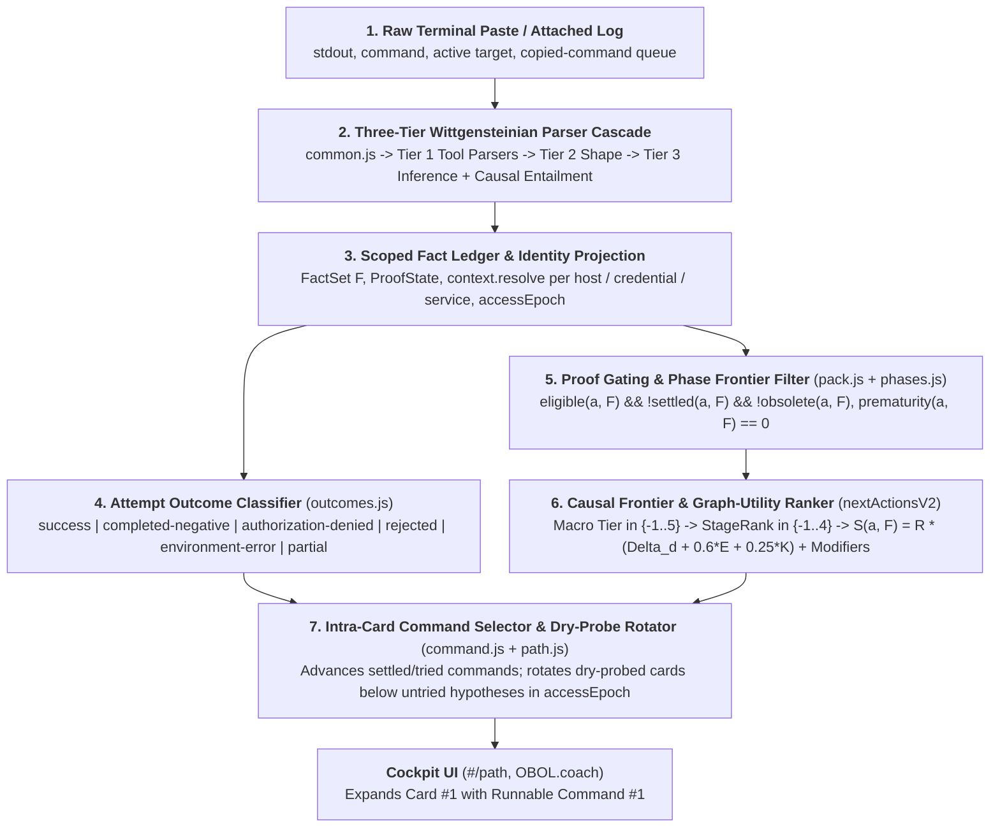

# The Causal Frontier & Graph-Utility Ranking Engine

> [!IMPORTANT]
> **Core Thesis**: Penetration testing is a sequential decision problem under partial observability. At step 0, an automated advisor cannot telepathically know which single exploit will compromise an unfamiliar target; instead, it must rank plausible actions in order of their **epistemic and causal utility** toward the engagement objectives, updating that ranking in closed-loop response to positive findings, negative probes, and access transitions. OBOL achieves this without fragile per-move weight tuning by combining **Strict Proof Gating**, a **7-Tier Causal Frontier Hierarchy**, an **AND/OR Attack-Graph Distance & Keystone Lookahead Formula**, **A\* Dependable Route Planning**, and **Epoch-Scoped Dry-Probe Recovery**.

This document is the companion to [`INFERENCE.md`](INFERENCE.md) (which documents how raw terminal outputs are parsed into structured facts via the Wittgensteinian Contextual Inference Engine) and [`ARCHITECTURE.md`](ARCHITECTURE.md) (which documents the overall browser-local application architecture). Together, [`INFERENCE.md`](INFERENCE.md) and `RANKING.md` provide a complete mathematical and architectural specification of OBOL from raw terminal bytes to ranked operator guidance.

---

## 1. The Complete End-to-End Epistemic Pipeline

Every interaction in OBOL follows a deterministic seven-stage closed loop across [`assets/engine/parsers/`](assets/engine/parsers/index.js), [`assets/engine/facts.js`](assets/engine/facts.js), [`assets/engine/context.js`](assets/engine/context.js), [`assets/engine/phases.js`](assets/engine/phases.js), [`assets/engine/pack.js`](assets/engine/pack.js), [`assets/engine/command.js`](assets/engine/command.js), [`assets/engine/outcomes.js`](assets/engine/outcomes.js), and [`assets/ui/routes/path.js`](assets/ui/routes/path.js):



---

## Notation & Formal Logic Quick Reference

Every formula in this specification is followed immediately by a plain-English explanation. Use the two tables below as a quick cheat sheet for any formal logic operator or OBOL engine variable.

### Logic & Set Notation

| Symbol | Plain-English Reading | Example in This Doc |
| :---: | :--- | :--- |
| $\land$ / $\lor$ / $\neg$ | **AND** (both hold) / **OR** (at least one holds) / **NOT** (does not hold) | $\text{eligible}(a, F) \land \neg\text{settled}(a, F)$ means eligible AND NOT settled |
| $\iff$ | **If and only if** (exact definition / two-way equivalence) | Defines the exact condition under which `eligible` or `settled` is true |
| $\forall$ / $\exists$ | **For every** item / **There is at least one** item | $\forall k \in \text{req}_{\text{all}}(a)$ means every required prerequisite fact $k$ |
| $\in$ / $\notin$ | **Is present in** / **Is not present in** a set or list | $k \in K(F)$ means fact kind $k$ is currently proven |
| $\subseteq$ | **Is a subset of** (every item on the left belongs to the set on the right) | $F \subseteq \mathcal{F}$ means scoped facts drawn from the full engagement store |
| $\cup$ / $\cap$ / $\setminus$ | **Combined with** (union) / **Overlap between** (intersection) / **Excluding** (difference) | $H_0 \cup \text{prod}(a)$ means current facts combined with the facts move $a$ produces |
| $\emptyset$ | **Empty set** (nothing present / list has zero items) | $\text{req}_{\text{any}}(a) = \emptyset$ means move $a$ has no `requires_any` list |
| $\lvert X \rvert$ | **Count of items** in set $X$ | $\lvert \text{eliminates}(a) \rvert$ means number of attack lanes move $a$ rules in or out |
| $\lbrace x \mid \text{cond} \rbrace$ | **The set of all $x$ where `cond` is true** (filtered set) | $\lbrace g \in G \mid g \notin K(F) \rbrace$ means all goals not yet proven |
| $\langle x_1, x_2, \dots \rangle$ | **Ordered sequence** (an array or list where position matters) | $\Phi = \langle \texttt{recon}_0, \dots, \texttt{loot}_5 \rangle$ lists the 6 ordered phases |
| $\to$ / $\mapsto$ / $\leftarrow$ | **Leads to** / **Maps input to output** / **Updates value to** | $(x, y) \mapsto \text{dry}(x) - \text{dry}(y)$ compares dry-attempt counts of two moves |
| $\sum$ / $\min$ / $\max$ | **Sum of** / **Smallest value of** / **Largest value of** | $\min_{g \in G_{\text{active}}} \text{fc}(g, H)$ picks the fewest steps to reach any open goal |
| $\mathbb{I}[\text{cond}]$ | **Indicator (`1` or `0`)**: equals `1` when `cond` holds, `0` otherwise | Multiplies a weight $w_i$ only when rule $i$ matches |
| $\infty$ | **Unreachable** (`V2_INF = 99` in code) | Returned when no chain of moves can produce a required fact |

### OBOL Engine & Scoring Symbols

| Symbol | Code Equivalent | Plain-English Meaning |
| :---: | :--- | :--- |
| $\mathcal{F}$, $F$, $F_{\text{ctx}}$, $f$ | `eng.facts`, `FactSet`, `OBOL.context.resolve`, `Fact` | $\mathcal{F}$ is the full engagement fact store, $F$ is a target-scoped subset, $F_{\text{ctx}}$ is the identity-filtered view, and $f$ is one individual fact record |
| $\mathcal{K}$, $K(F)$ | Fact `kind` vocabulary, `facts.kinds()` (`supported` only) | $\mathcal{K}$ is all possible dotted fact names (e.g. `port:445`); $K(F)$ is the set of fact names currently **proven** in $F$ |
| $H$, $H_0$, $H_a$ | Held-kind sets in [`pack.js`](assets/engine/pack.js) | $H$ is a working set of proven fact kinds: $H_0 = K(F)$ holds **before** move $a$, and $H_a = H_0 \cup \text{prod}(a)$ would hold **if move $a$ succeeded** |
| $\text{Epoch}(F)$ | `accessEpoch(facts)` | Fingerprint string of your current privilege, shell foothold, credentials, and hashes (`anon` when none are held); changing it resets dry-probe counters |
| $\mathcal{A}$, $a$, $\mathcal{L}(F)$ | `OBOL.packs.actions()`, `Action`, live candidates | $\mathcal{A}$ is the full 355-move library, $a$ (or $b, m, x, y$) is an individual move, and $\mathcal{L}(F)$ is the **live candidate pool** eligible and unfinished right now |
| $\text{req}_{\text{all}}(a)$, $\text{req}_{\text{any}}(a)$, $\text{prod}(a)$ | `a.requires_all`, `a.requires_any`, `a.produces` | Mandatory prerequisites (ALL must hold), trigger facts (AT LEAST ONE must hold), and output facts minted when move $a$ succeeds |
| $\Phi$, $\phi$, $\text{Reached}(F)$, $\text{Frontier}(F)$ | `OBOL.phases`, `targetPhase(facts)`, `frontierIndex` | $\Phi$ is the 6 kill-chain stages `0..5`, $\phi$ is a fact or move's stage index, $\text{Reached}(F)$ is the furthest stage proven so far, and $\text{Frontier}(F)$ is the active actionable stage |
| $\text{Tier}(a, F)$, $\text{StageRank}(a, F)$, $\mathbf{RankKey}$ | `tier` (`-1..5`), `stageRank` (`-1..4`), comparator in `nextActionsV2` | Macro Causal Frontier tier (endgame flags down to speculative gambles), sub-role priority within that tier, and the full left-to-right sort tuple |
| $G$, $G_{\text{active}}(F)$, $\mathcal{P}(k)$ | `V2_GOALS`, active unachieved goals, producer map | $G$ is all win conditions, $G_{\text{active}}(F)$ is win conditions **not yet achieved**, and $\mathcal{P}(k)$ is the set of moves capable of producing fact $k$ |
| $\text{fc}(k, H)$, $\text{mc}(m, H)$, $d(H, G_{\text{active}})$ | `v2GoalDistance` AND/OR recursion | $\text{fc}$ is minimum steps to obtain fact $k$ (OR-choice), $\text{mc}$ is minimum steps to run move $m$ (AND-sum), and $d$ is fewest steps from state $H$ to any open goal |
| $\Delta d(a, F)$ | `progA` (`v2ProgressFrom`) | **Direct Goal Progress**: how many steps closer to an open goal move $a$ takes you immediately |
| $R(a, F)$ | `v2Reliability(a, H)` | **Epistemic Prior Reliability**: confidence multiplier (`1.00` proven lead, `0.80` standard enum, `0.30` unindicated priv shortcut, `0.25` speculative gamble) |
| $U(a, F)$, $E(a, F)$, $K(a, F)$ | Newly unlocked moves, `enable`, `keystone` (`V2_KEYSTONE_CAP = 2.5`) | $U$ is follow-up moves unlocked by $a$, $E$ is the single best reliability-weighted follow-up step, and $K$ is the capped total breadth of doors opened by $a$ |
| $S(a, F)$ | `score` in `nextActionsV2` | **Expected Graph Utility Score** breaking ties within the same `(Tier, StageRank)` bucket |
| $\Omega_{\text{obj}}$, $\Phi_{\text{focus}}$, $\Phi_{\text{risk}}$, $\Psi_{\text{side}}$ | `V2_OBJECTIVE_W` (`+2.0`), `profileFocus` (`+0.5`), spray risk (`-0.5`), `deprioritize_when` (`5.0`) | Bounded score modifiers: uncaptured flag pull, machine-profile focus bonus, blind spray lockout penalty, and post-goal side-quest suppression |
| $\pi^{\ast}$, $c(a, H)$, $g(H)$, $h(H)$, $f(H)$ | `planPath`, `v2ActionCost`, A\* search cost | $\pi^{\ast}$ is the lowest-cost full route to a goal, $c$ is single-move cost, $g$ is cost spent so far, $h = d$ is optimistic steps left, and $f = g + h$ is A\* priority |
| $C(a)$, $c_i$, $\text{dry}(a)$ | `a.commands`, command $i$, `moveDryTriesInEpoch` | $C(a)$ is the ordered command list on move $a$, $c_i$ is command variant $i$, and $\text{dry}(a)$ counts conclusive 0-finding runs in the current Access Epoch |

---

## 2. Formal State Representation: Facts, Scopes, and Access Epochs

### Core Vocabulary: Tokens, Atoms, Facts, and Command Placeholders

Before introducing the state equations, it helps to separate four distinct terms used across [`INFERENCE.md`](INFERENCE.md) and `RANKING.md` (because "token" means something different in raw text parsing than it does in command templating, and neither is the same as an atom or a fact):

1. **Raw Output Tokens (parser input in [`INFERENCE.md`](INFERENCE.md))**: Uninterpreted whitespace- or delimiter-separated substrings sliced out of terminal output (such as `svc_loanmgr`, `445/tcp`, or a 32-character hex chunk). A raw token has no fixed semantic meaning on its own.
2. **Atoms (typed primitives in [`inference.js`](assets/engine/parsers/inference.js))**: Raw output tokens that match one of OBOL's ~45 protocol or OS primitive patterns (for example, classifying `10.10.10.5` as an IPv4 atom, `S-1-5-21-...` as a SID atom, or `$krb5tgs$...` as a Kerberos hash atom). Atoms are pattern-validated building blocks rather than proven engagement state.
3. **Facts**, $f \in \mathcal{F}$ (in [`facts.js`](assets/engine/facts.js)): Proven propositions about the target minted when parsers observe atoms in a valid structural and positive-polarity context. The ranking and planning engine operates **exclusively on facts**.
4. **Command Template Tokens (`{{token}}` in [`command.js`](assets/engine/command.js))**: Named placeholder slots inside a move's authored command string (such as `{{target}}`, `{{domain}}`, `{{user}}`, `{{hashfile}}`, or `{{flag_path}}`) that OBOL fills automatically from proven fact payloads. Placeholders listed in `EARNED_TOKENS` also act as readiness gates: a command variant is held back until proven facts supply every earned token it requires (see Section 8.1).

### 2.1 The Fact Tuple and Proof States ([`assets/engine/facts.js`](assets/engine/facts.js))

The engagement state is a finite set of structured facts $\mathcal{F} = \lbrace f_1, f_2, \dots, f_n \rbrace$. Each fact $f \in \mathcal{F}$ is a tuple:

```math
f = (\text{kind},\, \text{scope},\, \text{value},\, \text{state},\, \text{source},\, t_{\text{created}})
```

> **In plain English:** Every fact stored by OBOL is a 6-field record stating **what** was observed (`kind`, such as `port:445`), **where** it applies (`scope`, a specific host IP or AD domain), **extracted details** (`value`, such as a username/password or share name), **whether it was proven or disproven** (`state`: `supported`, `refuted`, or `inconclusive`), **which paste produced it** (`source`), and **when** it was recorded.

where:
- $\text{kind} \in \mathcal{K}$ is a hierarchical dotted predicate (e.g., `port:445`, `smb.readable_share`, `ad.acl_lead`, `credential.available`, `access.admin`, `objective.root_flag`).
- $\text{scope}$ binds the observation to a network entity (`host:<ip>` or `domain:<fqdn>`).
- $\text{value}$ is a structured JSON payload carrying extracted parameters (e.g., `{ user, password, nthash, domain }`, `{ targets: ["Exchange Windows Permissions"] }`, `{ path: "C:\\Users\\Administrator\\Desktop\\root.txt" }`).
- $\text{state} \in \lbrace \texttt{supported}, \texttt{refuted}, \texttt{inconclusive} \rbrace$ is the epistemic proof state (`OBOL.facts.ProofState`).
- $t_{\text{created}} \in \mathbb{R}^+$ is the monotonic timestamp of ingestion.

For any scoped fact set $F \subseteq \mathcal{F}$, the set of **proven fact kinds** is defined solely over $\texttt{supported}$ facts:

```math
K(F) = \{\, f.\text{kind} \mid f \in F \;\land\; f.\text{state} = \texttt{supported} \,\}
```

> **In plain English:** `K(F)` is simply the set of fact names (`kind` strings) inside `F` whose status is **proven** (`supported`). Facts marked `refuted` or `inconclusive` are excluded so failed logins or ambiguous checks never unlock downstream moves.

A `refuted` or `inconclusive` fact never satisfies a positive prerequisite gate. Deduplication is enforced on the canonical fingerprint $(\text{kind}, \text{scope}, \text{claim}(f))$.

### 2.2 Identity-Scoped Context Projection ([`assets/engine/context.js`](assets/engine/context.js))

In a multi-host, multi-credential engagement, flat global booleans cause cross-account and cross-host contamination (for example, an administrative proof earned on Host A or by Account 1 falsely unlocking privileged commands on Host B or for Account 2).

Before evaluating eligibility or command filling, `OBOL.context.resolve` constructs an identity-coherent projection $F_{\text{ctx}} = \Pi(\mathcal{F}, \text{target}, \text{credId}, \text{service}, \text{locus})$ - in plain terms, a filtered view of the engagement fact store scoped strictly to one target, one selected credential, one network service, and one execution location:

1. **Host Isolation**: Only facts scoped to `host:<target>` (and `domain:<fqdn>` when `<target>` is proven to belong to `<fqdn>`) enter $F_{\text{ctx}}$.
2. **Credential Coherence**: Username, plaintext password, NTLM hash, and authentication realm (`domain` vs. local `.`) are drawn atomically from the single selected credential $c^* = \text{credId}$, never mixing one principal's username with another principal's secret.
3. **Service-Scoped Privilege Proof**: Remote administrative facts (`access.admin`) are filtered by the command's transport service (`smb`, `winrm`, `ldap`, `wmi`, `ssh`) and the selected `credentialId`, while on-host session privileges (`access.system`, `foothold.windows`, `foothold.linux`) are available only to commands whose execution locus is `onhost` (`OBOL.pack.commandExecutionLocus(cmd) === 'onhost'`).

### 2.3 The Access Epoch Signature ([`accessEpoch` in `assets/engine/pack.js`](assets/engine/pack.js))

An operator frequently runs a probe under anonymous access (finding nothing), later recovers a domain credential, and later still escalates to Domain Admin. A command or move that failed or returned empty in an earlier privilege state must be re-eligible once new access is achieved.

OBOL formalizes this via the **Access Epoch function** $\text{Epoch}(F)$, which maps the current fact set to a canonical privilege-and-material state string:

```math
\text{Epoch}(F) = \text{join}\Big(\big[\, \text{adm}(F),\; \text{fh}(F),\; \text{creds}(F),\; \text{hashes}(F) \,\big]\Big)
```

> **In plain English:** The Access Epoch joins four summary tags into a single fingerprint string describing your current level of access and material: highest privilege (`root`, `system`, or `admin`), active shell foothold (`win`, `lin`, or `shell`), held credentials, and captured hash types. Whenever you gain a new credential, hash, shell, or admin level, this fingerprint changes - automatically unlocking previously dry commands so OBOL can re-test them under your newly earned access.

where:
- $\text{adm}(F) \in \lbrace \texttt{adm:root}, \texttt{adm:system}, \texttt{adm:admin}, \emptyset \rbrace$
- $\text{fh}(F) \in \lbrace \texttt{fh:win}, \texttt{fh:lin}, \texttt{fh:shell}, \emptyset \rbrace$
- $\text{creds}(F) = \texttt{cred:} + \text{sort}\big(\lbrace u : \text{secType} : \text{fingerprint}(v) \rbrace\big)$ over all held credentials
- $\text{hashes}(F) = \texttt{h:} + \text{sort}\big(\lbrace \texttt{asrep}, \texttt{tgs}, \texttt{ntlm} \rbrace \cap K(F)\big)$

If all four components are empty, $\text{Epoch}(F) = \texttt{anon}$. Whenever a new credential is recovered, a hash is captured, a foothold is landed, or administrative access is proven, $\text{Epoch}(F)$ transitions to a new string, automatically resetting epoch-scoped command-retry and dry-probe counters (`commandTriedInEpoch` and `moveDryTriesInEpoch`).

---

## 3. The Attack Graph: Proof Gating, Settlement, and Phase Prematurity

### 3.1 Move Declarations and Eligibility Gates ([`assets/engine/pack.js`](assets/engine/pack.js))

The move library $\mathcal{A}$ (`data/packs-bundle.js`, 355 moves across 19 packs) is a directed hypergraph where facts are vertices and moves are hyperedges. Each move $a \in \mathcal{A}$ declares:

- $\text{req}_{\text{all}}(a) \subseteq \mathcal{K}$: mandatory conjunctive prerequisite fact kinds.
- $\text{req}_{\text{any}}(a) \subseteq \mathcal{K}$: disjunctive trigger fact kinds (at least one must hold if non-empty).
- $\text{prod}(a) \subseteq \mathcal{K}$: outcome fact kinds minted when $a$ succeeds.
- $\text{os}(a) \subseteq \lbrace \texttt{linux}, \texttt{windows}, \texttt{macos} \rbrace$: operating system compatibility.
- $\text{locus}(a) \in \lbrace \texttt{R}, \texttt{F}, \texttt{I} \rbrace$: execution locus (`R` = Remote from attacker host, `F` = Foothold one-shot on target, `I` = Interactive on target).
- $\text{priority}(a) \in [0, 100]$: authored tie-breaking priority.
- $\text{transition}(a)$: semantic DAG transition role (e.g., `asrep_roast`, `crack_asrep`, `kerberoast`, `crack_tgs`, `map_acl`, `map_graph`, `map_manual`, `gpp`, `loot_browse`, `dcsync`, `privesc_orient`, `privesc_act`, `user_flag_win`, `root_flag_win`, `foothold_win`).

A move $a$ is **eligible** under fact set $F$ (`a.eligible(F)`) if and only if:

```math
\text{eligible}(a, F) \iff \text{osCompatible}(a, F) \;\land\; \Big(\forall k \in \text{req}_{\text{all}}(a),\, k \in K(F)\Big) \;\land\; \Big(\text{req}_{\text{any}}(a) = \emptyset \;\lor\; \exists k \in \text{req}_{\text{any}}(a),\, k \in K(F)\Big)
```

> **In plain English:** A move is allowed to run right now only when three checks pass: (1) it supports the target's operating system, (2) **every** mandatory prerequisite in its `requires_all` list is already proven, and (3) either it has no `requires_any` list or **at least one** trigger fact in `requires_any` is already proven.

### 3.2 Settlement and Obsolescence (`a.settled(F)` and `a.obsolete(F)`)

A move $a$ is **settled** when its epistemic purpose has already been fulfilled on the active target:

```math
\text{settled}(a, F) \iff \text{prod}(a) \neq \emptyset \;\land\; \Big(\forall k \in \text{prod}(a),\, k \in K(F)\Big) \;\land\; \neg\text{PartialUnfinished}(a, F)
```

> **In plain English:** A move is considered finished ("settled") once it declares at least one expected output fact, **every** output fact it promises to produce is already proven on the target, and its most recent run did not stop mid-way (such as a truncated scan or a multi-service credential validator that still has untested services left).

where $\text{PartialUnfinished}(a, F)$ holds if the most recent execution of $a$ was classified as `partial` (e.g., a truncated scan output) without a subsequent conclusive completion receipt, or if $a$ is a multi-service validator (`validate-credential`) with remaining untested services.

A move $a$ is **obsolete** (`a.obsolete(F)`) if a later achievement makes it redundant:
1. Any kind in `a.obsolete_when` is present in $K(F)$.
2. $a$ is a low-privilege foothold acquisition move (whose $\text{prod}(a)$ consists only of `access.shell`, `foothold.*`, or `web.*` kinds) and administrative or root access (`access.root`, `access.admin`, or `access.system`) is already held in $K(F)$.

Thus, the **live candidate set** $\mathcal{L}(F) \subseteq \mathcal{A}$ passed to the ranker is:

```math
\mathcal{L}(F) = \{\, a \in \mathcal{A} \mid \text{eligible}(a, F) \;\land\; \neg\text{settled}(a, F) \;\land\; \neg\text{obsolete}(a, F) \;\land\; a.\text{id} \notin \text{Done}(F) \,\}
```

> **In plain English:** The live candidate pool handed to the ranker consists of all moves in the 355-move library that are **currently allowed to run** (`eligible`), **not yet finished** (`settled`), **not superseded by higher access** (`obsolete`), and **not manually checked off** (`Done`) by the operator.

### 3.3 The Six-Phase Frontier Model ([`assets/engine/phases.js`](assets/engine/phases.js))

Independent of the fine-grained ranker, OBOL projects the engagement onto an ordered six-phase sequence:

```math
\Phi = \langle \texttt{recon}_0,\, \texttt{enum}_1,\, \texttt{creds}_2,\, \texttt{access}_3,\, \texttt{escalate}_4,\, \texttt{loot}_5 \rangle
```

> **In plain English:** OBOL organizes a penetration test into six ordered stages from start (`0`) to finish (`5`): Reconnaissance (`0`), Enumeration (`1`), Credential Recovery (`2`), Initial Access (`3`), Privilege Escalation (`4`), and Looting / Proof Capture (`5`).

Each fact kind $k \in \mathcal{K}$ maps to a phase index $\phi(k) \in \lbrace 0, \dots, 5 \rbrace$ via longest-prefix matching (`PHASE_RULES`). The target's current reached phase and active frontier index are:

```math
\text{Reached}(F) = \max_{k \in K(F)} \phi(k), \qquad \text{Frontier}(F) = \min\big(5,\, \text{Reached}(F) + 1\big)
```

> **In plain English:** `Reached(F)` is the furthest kill-chain stage (`0` through `5`) proven by any fact you hold so far. `Frontier(F)` is one stage ahead of `Reached(F)` (capped at stage `5`), marking the furthest stage OBOL treats as immediately actionable rather than premature.

The **prematurity** of a move $a$ with phase $\phi(a)$ is:

```math
\text{prematurity}(a, F) = \max\big(0,\, \phi(a) - \text{Frontier}(F)\big)
```

> **In plain English:** Prematurity counts how many stages ahead of your active frontier a move sits. Moves at or behind your frontier have prematurity `0` (shown under **Ready Now**); moves two or more stages ahead of what you have proven so far have prematurity `1` or higher (parked under **Coming Up**).

In the Cockpit UI ([`assets/ui/routes/path.js`](assets/ui/routes/path.js), `OBOL.coach` in code), moves in $\mathcal{L}(F)$ with $\text{prematurity}(a, F) = 0$ and at least one runnable, untried command populate **Ready Now (`onFlow`)**; moves with $\text{prematurity}(a, F) > 0$ populate **Coming Up (`comingUp`)**; and informational writeup checks (`isReportOnly(a, A)`) populate **Report Checks (`reportChecks`)**.

---

## 4. Why Pure Priority Weights Fail: The Theory of Causal Frontier Tiers

### 4.1 The Fragility of Flat Weight Ladders

In a traditional weighted-sum recommender, every rule adds a numeric bonus $+w_i$ to a single scalar score:

```math
S_{\text{legacy}}(a, F) = S_{\text{graph}}(a, F) + \sum_{i} w_i \cdot \mathbb{I}[\text{rule}_i(a, F)]
```

> **In plain English:** A traditional single-number recommender starts with a base graph score and adds bonus points (`w_i`) for every heuristic rule that move `a` matches. As detailed below, mixing kill-chain stage priority and graph math into a single flat sum makes rankings fragile as move packs grow.

In a stateful penetration testing engine, this architecture suffers from three structural failure modes:

1. **The Recency Window Decay Trap**: If "newly unlocked" moves are detected solely by a wall-clock timestamp window (for example, facts created within $\Delta t \le 2\text{ s}$ of $\max t$), then as soon as an operator runs a single post-authentication command (such as reading `user.txt` 10 seconds after validating a credential), the credential fact ages out of the 2-second window. All remaining credential-unlocked moves drop back to the baseline tier unless ad-hoc rules forcibly pin them upward.
2. **Macro-Stage Collision in a Flat Tier**: Once multiple engagement stages (pre-auth discovery, authenticated enumeration, active hash cracking, ACL exploitation, and endgame flag capture) are all pinned into the same tier (`tier = 2`), the only way to prevent an earlier stage's move from outranking a later stage's move is to invent an escalating ladder of magic weights $(+3.0, +4.5, +5.8, +6.0, +7.0, +24.0)$.
3. **Cross-Term Interference**: Because those stage bonuses are added directly into the continuous graph utility score $S_{\text{graph}}(a, F)$, any change to the move pack that alters a move's fan-out (`keystone`) or graph distance (`progA`) can shift $S_{\text{graph}}$ by $0.5\text{ - }2.0$ points, causing one rule's $+4.5$ move to unexpectedly leapfrog another rule's $+5.8$ move.

### 4.2 Structural Separation: Macro-Stage Tier vs. Micro-Stage Role vs. Graph Utility

OBOL resolves all three failure modes by decomposing ranking into three strictly orthogonal, lexicographically ordered dimensions in [`nextActionsV2`](assets/engine/pack.js):

```math
\mathbf{RankKey}(a, F) = \big(\text{Tier}(a, F),\; \text{StageRank}(a, F),\; S(a, F),\; \text{priority}(a),\; -\text{toolkitRank}(a),\; -\text{locusRank}(a)\big)
```

> **In plain English:** Instead of adding everything into one number, OBOL sorts moves column-by-column from left to right: **Macro Frontier Tier** decides first; ties inside the same tier break by **Stage Role** (`StageRank`); ties there break by the **Graph Utility Score** (`S`); and any remaining ties break by **authored priority**, **preferred house tool** (smaller rank number wins), and **remote-first execution** (running from Kali beats running on-host).

1. **Macro-Stage Causal Frontier Tier**, $\text{Tier}(a, F) \in \lbrace -1, 0, 1, 2, 3, 4, 5 \rbrace$: Encodes **which causal frontier of the kill-chain** the move belongs to given the current persistent state $K(F)$. Because Tier 5 $>$ Tier 4 $>$ Tier 3 $>$ Tier 2 $>$ Tier 1 $>$ Tier 0 $>$ Tier $-1$ is a strict lexicographic partition, an Earned Material transform in Tier 4 (such as cracking a captured TGS hash or abusing a discovered writable ACL) **automatically** ranks above every general authenticated probe in Tier 3, with zero magic weights added to $S(a, F)$.
2. **Within-Tier Structural Role**, $\text{StageRank}(a, F) \in \lbrace -1, 0, 1, 2, 3, 4 \rbrace$: Orders the operational sub-roles within the same macro-tier by action cost and directness (e.g., within Tier 3: capturing an unmet 1-command local flag objective $>$ running a 1-command fast escalation probe $>$ running a multi-step whole-domain graph collector $>$ manual enumeration).
3. **Pure Graph Utility Score**, $S(a, F) \in \mathbb{R}$: Breaks ties between moves sharing the exact same $(\text{Tier}, \text{StageRank})$ using the topology of the attack graph (goal-distance reduction $\Delta d$, 1-step enablement $E$, and keystone breadth $K$, scaled by epistemic reliability $R$).

### 4.3 Complete Specification of the 7 Causal Frontier Tiers

Each live move $a \in \mathcal{L}(F)$ is initialized to its base epistemic tier:

```math
\text{Tier}_{\text{base}}(a, F) = \begin{cases}
-1 & \text{if } \text{Speculative}(a, F) \land \neg\text{Earned}(a, F) \\
2 & \text{if } \text{Fresh}(a, F) \\
1 & \text{if } \text{Earned}(a, F) \\
0 & \text{otherwise}
\end{cases}
```

> **In plain English:** Before high-priority stage promotions (Tiers 3 through 5) are applied, every eligible move starts in one of four base tiers: **`-1` (Speculative)** for blind gambles with no supporting evidence indicator; **`2` (Fresh)** for moves newly unlocked by your most recent paste; **`1` (Earned)** for evidence-backed moves unlocked in an earlier step that are still open; or **`0` (Baseline)** for routine general enumeration.

where $\text{Fresh}(a, F) \iff \text{eligible}(a, K(F)) \land \neg\text{eligible}(a, K_{\text{before}}(F))$ - in plain terms, move $a$ is eligible now, whereas it was *not* eligible before the latest paste (subject to anti-thrash guards that suppress low-level recon pings when a high-value lead is already held, and defer generic host LPE fallbacks `a.dcDefer` on unmapped Domain Controllers).

The promotion operator $\text{promote}(t, r)$ then elevates $(\text{Tier}, \text{StageRank}) \leftarrow \max\big((\text{Tier}, \text{StageRank}), (t, r)\big)$ across the active persistent state - raising a move's `(Tier, StageRank)` pair whenever it qualifies for a higher frontier stage below, while never lowering an already-higher assignment:

| Causal Frontier Tier | Sub-Role (`stageRank`) | Persistent State Condition & Transition Role | Operational Meaning |
| :--- | :---: | :--- | :--- |
| **Tier 5: Endgame Cash-In Frontier** | `5.3` | Admin/System/Root held (or `credentialProbeAllowed`) $\land$ uncaptured `objective.root_flag` | Immediate root/administrator flag proof capture (`root_flag_win` / `flag-hunt-root-*`). |
| | `5.2` | `adPosture == dcsync_ready` (with `ad.control_paths` $\in K(F)$ held) before `loot.ntds` / `access.admin`, OR Admin held with uncaptured `objective.local_flag` | Domain takeover cash-in (`dcsync`) or remaining local flag proof capture after admin compromise. |
| | `5.1` | Admin/System/admin-cred held on Windows surface $\land$ `access.shell` $\notin K(F)$ $\land$ `transition == foothold_win` | Establishing an interactive administrative shell (`win-interactive-shell`) once flags are handled. |
| **Tier 4: Earned Material / Active Lead in Hand** | `4.4` | `hash.tgs` $\in K(F)$ (`crack_tgs`), `hash.asrep` $\in K(F)$ (`crack_asrep`), or `gpp_cpassword` candidate in hand (`gpp`) | Deterministic offline secret recovery from a captured cryptographic artifact. |
| | `4.3` | Confirmed `ad.acl_lead` / `ad.group_joined` / `ad.attack_paths` (`map_acl`), confirmed host privesc vector (`privesc_act`), `ad.user_list` pre-cred (`asrep_roast`), or `loot.files` / `config.review` (`gpp`) | Immediate exploitation of a proven vulnerability, writable ACL, user list, or downloaded policy file. |
| | `4.2` | Secondary ACL abuse (`ad-acl-abuse`) or readable SMB share pre-cred (`gpp`, `loot_browse`) | Share spidering, file extraction, and on-host ACL abuse twin. |
| **Tier 3: Authenticated / Foothold Frontier** | `3.4` | `validateFirst` (`credential.validated` producer), OR credential/foothold held on active Windows surface with uncaptured `objective.local_flag` (`user_flag_win`) | Validating a newly recovered credential first, then capturing the reachable user flag (`user.txt`). |
| | `3.3` | Authenticated AD unmapped fast probes (`map_acl`, `kerberoast`), or unindicated host foothold orientation (`privesc_orient`, `linux-enum`, `windows-enum`) | Single-command escalation probes (`bloodyad-acl`, `kerberoast`) and initial local privesc sweeps. |
| | `3.2` | Authenticated AD unmapped graph collection (`map_graph`) | Automated whole-domain graph collection (`bloodhound-collect`). |
| | `3.1` | Authenticated AD manual path-finding (`map_manual`), interactive user shell (`foothold_win`), or fallback local flag | Multi-step manual LDAP/DACL enumeration (`ad-path-manual`) and interactive foothold login. |
| **Tier 2: Pre-Auth Surface & Fresh Recon** | `2.2` | Post-version-scan anonymous AD openers (`recon-smb-anon`, `ad-anon-ldap-enum`, `ad-user-enum`) or non-AD web content discovery (`recon-web-triage`, `content-discovery`, etc.) | Primary unauthenticated attack-surface enumeration after port/service discovery. |
| | `2.0` | All other freshly unlocked moves $(\text{Fresh}(a, F) = \text{true})$ | Newly unlocked service probes from the latest evidence batch. |
| **Tier 1: Indicated Frontier** | `1.0` | $\text{Earned}(a, F) = \text{true}$ from an earlier batch | Evidenced moves unlocked in prior turns that remain available. |
| **Tier 0: Baseline Frontier** | `0.0` / `-1` | Standard eligible moves (with passive L2 poisoners / optional NSE scans at `stageRank = -1`) | General methodology moves and passive listeners (`responder`, `mitm6`). |
| **Tier -1: Speculative Frontier** | `-1` | $\text{Speculative}(a, F) \land \neg\text{Earned}(a, F)$, or cross-OS / non-AD mismatch | Blind CVE exploits, unindicated password sprays, and out-of-context moves. |

---

## 5. Mathematical Formulation of Graph Distance, Reliability, and Utility Score

Within any `(Tier, StageRank)` bucket, OBOL ranks moves by their **Expected Graph Utility Score** $S(a, F)$. Every term in $S(a, F)$ is computed directly from the wiring of the move graph $\mathcal{A}$ and the current fact set $F$.

### 5.1 Recursive AND/OR Attack-Graph Distance (`v2GoalDistance`)

Let $G$ be the engagement goal set. With flags enabled (`V2_GOALS`):

```math
G = \{\texttt{objective.root\_flag},\; \texttt{objective.local\_flag},\; \texttt{objective.flag},\; \texttt{access.root},\; \texttt{access.admin},\; \texttt{access.system},\; \texttt{loot.ntds},\; \texttt{ad.domain\_admin}\}
```

> **In plain English:** When flag hunting is enabled (exam / CTF mode), winning goals include capturing a root, user, or general proof flag, gaining `root` / `Administrator` / `SYSTEM` access, dumping Active Directory's `NTDS.dit` database, or proving Domain Admin control.

With flags disabled (`V2_GOALS_NO_FLAGS`):

```math
G_{\text{no-flags}} = \{\texttt{access.root},\; \texttt{access.admin},\; \texttt{access.system},\; \texttt{loot.ntds},\; \texttt{ad.domain\_admin}\}
```

> **In plain English:** When flag hunting is disabled (client assessment mode), flag files are omitted and the winning goals are strictly full host or domain administrative compromise.

To prevent an already-achieved intermediate goal (such as `objective.local_flag` after capturing `user.txt`) from zeroing the distance to the remaining goals, `nextActionsV2` defines the **active unachieved goal set**:

```math
G_{\text{active}}(F) = \begin{cases}
\{\, g \in G \mid g \notin K(F) \,\} & \text{if } \{\, g \in G \mid g \notin K(F) \,\} \neq \emptyset \\
G & \text{otherwise}
\end{cases}
```

> **In plain English:** `G_active(F)` filters the goal list down to **only the goals you have not achieved yet**. Capturing `user.txt` early will not trick the ranker into thinking the engagement is 0 steps from finished while `root.txt` and `SYSTEM` are still open. (Once every goal has been achieved, it falls back to the full goal set `G`.)

For any set of held fact kinds $H \subseteq \mathcal{K}$, let $\mathcal{P}(k) = \lbrace m \in \mathcal{A} \mid k \in \text{prod}(m) \rbrace$ be the set of moves that produce fact kind $k$. The minimal step distance $d(H, G_{\text{active}})$ through the AND/OR prerequisite hypergraph is defined mutually recursively over fact nodes $\text{fc}(k)$ (OR-nodes) and move nodes $\text{mc}(m)$ (AND-nodes):

```math
\text{fc}(k, H) = \begin{cases}
0 & \text{if } k \in H \\
\min_{m \in \mathcal{P}(k)} \text{mc}(m, H) & \text{if } \mathcal{P}(k) \neq \emptyset \\
\infty & \text{otherwise}
\end{cases}
```

> **In plain English:** The step cost to obtain a single fact `k` from your current state `H` is **`0` steps** if you already hold `k`; otherwise it is **the cheapest move cost** among all moves capable of producing `k` (an **OR** choice, since you only need one producer move to succeed); or **unreachable** (`99` in code) if no move in the library produces `k`.

```math
\text{mc}(m, H) = 1 + \sum_{r \in \text{req}_{\text{all}}(m)} \text{fc}(r, H) + \begin{cases}
\min_{r \in \text{req}_{\text{any}}(m)} \text{fc}(r, H) & \text{if } \text{req}_{\text{any}}(m) \neq \emptyset \\
0 & \text{if } \text{req}_{\text{any}}(m) = \emptyset
\end{cases}
```

> **In plain English:** The step cost to execute move `m` from state `H` equals **`1` step for move `m` itself**, plus the **sum** of steps needed to earn **all** missing prerequisites in `requires_all` (an **AND** requirement), plus the **single cheapest** trigger option from `requires_any` (if `requires_any` is non-empty).

with cycle detection (returning $\text{fc}(k, H) = \infty$ if $k$ is already on the active recursion stack) and memoization ceiling `V2_INF = 99`. The distance from state $H$ to the active goal set is:

```math
d(H, G_{\text{active}}) = \min_{g \in G_{\text{active}}} \text{fc}(g, H)
```

> **In plain English:** Your current goal distance (`d`) is the **fewest total moves** required to reach *any* still-unachieved goal in `G_active` from your current proven facts `H`.

### 5.2 Direct Goal Progress $\Delta d(a, F)$ (`v2ProgressFrom`)

Let $H_0 = K(F)$ be the currently proven fact kinds, $d_0 = d(H_0, G_{\text{active}})$, and $H_a = H_0 \cup \text{prod}(a)$ be the hypothetical fact set after move $a$ succeeds, with $d_a = d(H_a, G_{\text{active}})$. The **Direct Goal Progress** $\Delta d(a, F)$ (`progA`) is:

```math
\Delta d(a, F) = \begin{cases}
0 & \text{if } d_0 \ge \infty \;\land\; d_a \ge \infty \\
5 & \text{if } d_0 \ge \infty \;\land\; d_a < \infty \\
\max(0,\, d_0 - d_a) & \text{otherwise}
\end{cases}
```

> **In plain English:** Direct Goal Progress (`progA`) measures how many steps closer to an open goal move `a` takes you if it succeeds: **`0`** if goals were unreachable before and remain unreachable after; **`5`** if no goal path existed yet and move `a` bridges you onto a valid path to a goal; or **`d_0 - d_a`** (floored at `0`), the exact number of steps shaved off the shortest path to an open goal.

### 5.3 Epistemic Prior Reliability $R(a, F)$ (`v2Reliability`)

Not all moves in an attack graph are equally likely to succeed. A move that exploits a **confirmed** vulnerability or cracks an **already captured** hash is near-deterministic, whereas firing a kernel exploit or password spray without a prior indicator is a low-probability gamble.

OBOL defines three epistemic predicates over a move $a$ and held kinds $H$:

1. **Evidence Fact (`v2EvidenceFact(k)`)**: A fact kind $k$ is hard evidence if it matches:
   - `V2_EVIDENCE_RE`: `/^(credential\.|hash\.|kerberos\.tickets|foothold\.|access\.|privesc\.|ad\.|smb\.(shares|null_session|guest_session|writable_share|ms17_010)|web\.|http\.(methods|exposed)|db\.|mssql\.|service\.version|vuln\.|exploit\.|loot\.|file\.|snmp\.|nfs\.|ftp\.|redis\.|rsync\.|tftp\.|dns\.zone|sccm\.|adcs\.)/`
   - excluding pure reachability/discovery facts (`*.reachable`, `ad.dc_candidate`, `ad.domain_known`, `ad.base_dn`).
   - **Specific Vulnerability / Artifact Fact (`V2_SPECIFIC_RE`)**: `/^(vuln\.|exploit\.|privesc\.|adcs\.vulnerable|smb\.(ms17_010|writable_share)|http\.(methods|exposed)|web\..*confirmed|file\.|db\.admin|mssql\.linked|ad\.(acl_lead|control_paths|gpo_writable|zerologon|nopac|maq_allow|coerced_auth|unconstrained|delegation|sid_history|computer_added)|sccm\.)/` (excluding generic `privesc.leads` and `vuln.candidates`).
2. **Earned Move (`v2Earned(a, H)`)**: Move $a$ is *earned* if:
   - it is not tagged `a.speculative`, OR one of its gate facts in $H$ is a specific indicator (`V2_SPECIFIC_RE`); **AND**
   - if $a$ claims a privilege goal (`V2_PRIV`: `access.root`, `access.admin`, `access.system`, `loot.ntds`, `ad.domain_admin`) or is an AD-lead consumer, it is backed by a satisfied specific indicator (`V2_SPECIFIC_RE`) or hard credential/access (`credential.available`, `hash.ntlm`, `hash.krbtgt`, `kerberos.tickets`, `access.admin`, `access.system`, `access.root`) in $H$; otherwise it is backed by any satisfied `v2EvidenceFact` gate in $H$.
3. **Speculative Move (`v2Speculative(a, H)`)**: Move $a$ is *speculative* if:
   - $a.\text{speculative} = \text{true}$ and none of its gate facts in $H$ satisfies `V2_SPECIFIC_RE`; **OR**
   - $a$ is not indicated (`!v2Indicated(a, H)`) yet claims a foothold (`foothold.*`, `access.shell`, `web.rce`) or a validated credential (`credential.available`, `credential.plaintext`).

From these predicates, the **Epistemic Prior Reliability** $R(a, H) \in \lbrace 1.00, 0.80, 0.30, 0.25 \rbrace$ is:

```math
R(a, H) = \begin{cases}
1.00 & \text{if } \text{Earned}(a, H) \quad \text{(proven indicator or captured material in hand)} \\
0.25 & \text{if } \text{Speculative}(a, H) \quad \text{(unindicated exploit / blind spray gamble)} \\
0.30 & \text{if } \neg\text{Earned}(a, H) \;\land\; \text{prod}(a) \cap \texttt{V2\_PRIV} \neq \emptyset \quad \text{(unindicated privilege shortcut)} \\
0.80 & \text{otherwise} \quad \text{(standard deterministic enumeration / discovery)}
\end{cases}
```

> **In plain English:** Reliability acts as a confidence multiplier (`25%` to `100%`) weighting a move's expected payoff: **`1.00`** when backed by a confirmed vulnerability, writable ACL, credential, or captured hash; **`0.80`** for normal deterministic enumeration; **`0.30`** for unindicated privilege-escalation shortcuts claiming admin/root without specific evidence; and **`0.25`** for blind gambles like unindicated CVE exploits or password sprays.

### 5.4 One-Step Deepest Enablement $E(a, F)$ and Bounded Keystone Breadth $K(a, F)$

A pivotal intermediate move (such as dumping a user list, collecting a TGS hash, or validating a credential) may not reach a terminal flag in 1 step $(\Delta d(a, F) = 0)$, but it **unlocks** downstream moves that do.

Let $U(a, F)$ be the set of moves in $\mathcal{A}$ that are currently **ineligible** under $H_0 = K(F)$ but become **eligible** under $H_a = H_0 \cup \text{prod}(a)$:

```math
U(a, F) = \{\, b \in \mathcal{A} \setminus \{a\} \mid \neg\text{eligible}(b, H_0) \;\land\; \text{eligible}(b, H_a) \,\}
```

> **In plain English:** `U(a, F)` is the set of **new doors opened by move `a`** - every other move in the library that is locked right now, but would immediately become unlocked (`eligible`) if move `a` succeeded.

For each newly unblocked move $b \in U(a, F)$, let $R_b = R(b, H_a)$ be its reliability in the post-move state $H_a$, and let $\Delta d_b(a, F)$ be its goal progress from $H_a$:

```math
\Delta d_b(a, F) = \begin{cases}
1 & \text{if } \text{InEscalationWindow}(H_0) \;\land\; \texttt{hash.tgs} \in \text{prod}(a) \setminus H_0 \;\land\; \texttt{credential.available} \in \text{prod}(b) \\
\text{v2ProgressFrom}(d_a,\, H_a,\, \text{prod}(b),\, \mathcal{P},\, G_{\text{active}}) & \text{otherwise}
\end{cases}
```

> **In plain English:** For each newly unlocked follow-up move `b`, OBOL calculates how many steps closer to a goal `b` would take you next. Special case: when you already hold a low-privilege login (not yet admin) and move `a` captures a fresh Kerberos service ticket (`hash.tgs`) that `b` can crack into a *second, potentially privileged* account, OBOL credits `b` with `1` step of progress even though the generic fact name `credential.available` is already present.

where $\text{InEscalationWindow}(H_0) \iff \texttt{credential.available} \in H_0 \land H_0 \cap \lbrace \texttt{access.admin}, \texttt{access.system}, \texttt{loot.ntds} \rbrace = \emptyset$ (in plain terms: you hold a non-admin credential, and have not yet achieved `admin`, `SYSTEM`, or an `NTDS.dit` dump).

From $U(a, F)$, OBOL computes two 1-step lookahead quantities:

**1. Deepest 1-Step Enablement $E(a, F)$ (`enable`)** - the single highest reliability-weighted progress among all doors that $a$ opens:

```math
E(a, F) = \max_{b \in U(a, F)} \big(R_b \cdot \Delta d_b(a, F)\big) \qquad (\text{with } E(a, F) = 0 \text{ if } U(a, F) = \emptyset)
```

> **In plain English:** Deepest Enablement (`enable`) inspects every follow-up move `b` that move `a` would unlock and takes the **single highest reliability-weighted goal step** among them (`0` if `a` unlocks nothing). It rewards setup moves that directly tee up a high-confidence winning strike.

**2. Bounded Keystone Breadth $K(a, F)$ (`keystone`)** - the reliability-tempered breadth of the attack surface unblocked by $a$, giving every newly unblocked move $b \in U(a, F)$ a base weight of $0.5$ plus its goal progress $\Delta d_b(a, F)$, capped at $K_{\max} = 2.5$ (`V2_KEYSTONE_CAP`):

```math
K_{\text{raw}}(a, F) = \min\left(2.5,\; \sum_{b \in U(a, F)} R_b \cdot \big(0.5 + \Delta d_b(a, F)\big)\right)
```

> **In plain English:** Raw Keystone Breadth (`keystone`) sums up **how wide an attack surface move `a` opens**: each newly unlocked follow-up move `b` adds `0.5` base points plus its own goal progress, weighted by `b`'s reliability, up to a hard ceiling of `2.5` so a noisy move unlocking dozens of minor checks cannot overpower direct goal progress.

Because keystone fan-out is a **middle-game** pivot metric (meant to help reach a winning position, never to displace an endgame cash-in or promote post-compromise persistence), $K(a, F)$ is zeroed for direct privilege cash-ins and deprioritized side-quests:

```math
K(a, F) = \begin{cases}
0 & \text{if } \big(\text{prod}(a) \cap \texttt{V2\_PRIV} \neq \emptyset\big) \;\lor\; \big(\texttt{deprioritize\_when}(a) \cap H_0 \neq \emptyset\big) \\
K_{\text{raw}}(a, F) & \text{otherwise}
\end{cases}
```

> **In plain English:** Keystone breadth drops to **`0`** whenever move `a` is already a direct admin/root cash-in or has been marked as a post-compromise side quest (`deprioritize_when`), keeping breadth bonuses focused strictly on middle-game discovery and pivoting.

### 5.5 The Complete Graph Utility Score Formula $S(a, F)$

Combining Direct Progress $\Delta d(a, F)$, Deepest Enablement $E(a, F)$, Keystone Breadth $K(a, F)$ (with weight $w_K = 0.25$), Epistemic Prior Reliability $R(a, F)$, and bounded situational modifiers yields the complete scoring equation in [`nextActionsV2`](assets/engine/pack.js):

```math
S(a, F) = R(a, F) \cdot \Big(\Delta d(a, F) + 0.6 \cdot E(a, F) + 0.25 \cdot K(a, F)\Big) + \Omega_{\text{obj}}(a, F) + \Phi_{\text{focus}}(a) + \Phi_{\text{risk}}(a, F) - \Psi_{\text{side}}(a, F)
```

> **In plain English:** Within the same `(Tier, StageRank)` bucket, a move's score is its **reliability** (`0.25` to `1.00`) multiplied by three graph payoffs - **direct steps saved toward a goal** (`1.0x`), **best follow-up move unlocked** (`0.6x`), and **total breadth of doors opened** (`0.25x`, capped at `2.5`) - plus bounded nudges for **uncaptured flags** (`+2.0`) and **machine-profile focus** (`+0.5`), minus penalties for **blind password-spray lockout risk** (`-0.5`) or **already-moot side quests** (`-5.0`).

where every modifier is explicitly bounded and defined. First, **Endgame Uncaptured Objective Pull**, $\Omega_{\text{obj}}(a, F)$:

```math
\Omega_{\text{obj}}(a, F) = \begin{cases}
2.0 \quad (\texttt{V2\_OBJECTIVE\_W}) & \text{if flags enabled } \land \exists p \in \text{prod}(a) \cap \{\texttt{objective.root\_flag},\; \texttt{objective.local\_flag},\; \texttt{objective.flag}\} \text{ with } p \notin H_0 \\
0 & \text{otherwise}
\end{cases}
```

> **In plain English:** When flag hunting is enabled and move `a` directly captures an uncollected flag (`root_flag`, `local_flag`, or `flag`), it receives an extra **`+2.0` score pull** so grabbing a reachable flag never loses a tie to lateral enumeration.

The remaining three modifiers are:

- **Profile Focus Alignment**, $\Phi_{\text{focus}}(a)$: $+0.5$ if any fact in $\text{prod}(a)$ matches the active machine profile's `focusPrefixes` (e.g., `ad.` on an AD profile), else $0$.
- **Blind Spray Risk Penalty**, $\Phi_{\text{risk}}(a, F)$: $-0.5$ if $\text{transition}(a) = \texttt{spray}$ and neither `policy.lockout` nor `smb.null_session` is proven in $H_0$ (penalizing account-lockout risk), else $0$.
- **Deprioritized Side-Quest Suppression**, $\Psi_{\text{side}}(a, F)$: $+5.0$ if `a.deprioritize_when` intersects $H_0$ (e.g., ticket-forging persistence once `loot.ntds` is already held), else $0$. (Cross-context mismatches - AD moves on non-AD boxes or Windows shell moves without a Windows surface - are sent to $\text{Tier} = -1$, $\text{StageRank} = -1$ with penalty $-20$ / $-10$).

#### Worked Numerical Example: Authenticated AD Frontier (`Tier = 3, StageRank = 3`)

Suppose the operator has validated a low-privilege domain user (`credential.available`, `credential.validated`) on an unmapped AD Domain Controller (`port:88`, `port:389`, `port:445`, `ad.domain_known`) and captured `user.txt` (`objective.local_flag`). Three moves compete in `Tier = 3, StageRank = 3` (with `laps-read` in `Tier = 0`):

1. **`bloodyad-acl` (`map_acl`, priority 92)**:
   - Unblocks 6 moves (`dcsync`, `shadow-credentials`, `delegation-abuse`, `ad-acl-abuse`, `dnsadmins-abuse`, `crack-identify`).
   - Because `dcsync` is earned under $H_a$ $(R_b = 1.0)$ and reaches `loot.ntds` in 1 step $(\Delta d_b = 1)$, $E = 1.0 \times 1 = 1.0$, and $K = \min(2.5, \sum R_b(0.5 + \Delta d_b)) = 2.5$.
   - $S(\texttt{bloodyad-acl}, F) = 0.80 \times (0 + 0.6(1.0) + 0.25(2.5)) = \mathbf{0.980}$.
2. **`kerberoast` (`kerberoast`, priority 89)**:
   - Unblocks 3 moves (`crack-tgs` with $R_b = 1.0$ and $\Delta d_b = 1$ via escalation-aware lookahead; `crack-identify` and `crack-kerberoast` with $R_b = 0.8$ and $\Delta d_b = 0$).
   - $E = 1.0 \times 1 = 1.0$, and $K = 1.0(0.5 + 1.0) + 0.8(0.5) + 0.8(0.5) = 2.3$.
   - $S(\texttt{kerberoast}, F) = 0.80 \times (0 + 0.6(1.0) + 0.25(2.3)) = \mathbf{0.940}$.
3. **`laps-read` (narrow attribute read, priority 92)**:
   - Unblocks 1 move (`crack-identify` with $R_b = 0.8$ and $\Delta d_b = 0$).
   - $E = 0$, $K = 0.8(0.5) = 0.4$.
   - $S(\texttt{laps-read}, F) = 0.80 \times (0 + 0 + 0.25(0.4)) = \mathbf{0.080}$.

Purely from graph wiring (6 unblocked doors $>$ 3 unblocked doors $>$ 1 unblocked door), $S(\texttt{bloodyad-acl}) = 0.980 > S(\texttt{kerberoast}) = 0.940 > S(\texttt{laps-read}) = 0.080$, with zero per-move magic weights.

---

## 6. The 11-Level Lexicographic Sort & Tie-Breaking Hierarchy

Given the scored candidate list, `nextActionsV2` ([`assets/engine/pack.js`](assets/engine/pack.js)) sorts moves $x, y \in \mathcal{L}(F)$ using a strict 11-level lexicographic comparator:

1. **Selected-Identity Validation Guard (`selectedIdentityPending`)**: When the operator has explicitly selected an unvalidated credential in the UI context bar, moves that can validate that identity (`credential.validated` in $\text{prod}(a)$ or `credentialProbeAllowed(a, F)`) sort first.
2. **Causal Frontier Tier (`y.tier - x.tier`)**: Higher macro-stage frontier tier $(\text{Tier} \in \lbrace 5, 4, 3, 2, 1, 0, -1 \rbrace)$ wins.
3. **Opening Diagnostic & Elimination Breadth (`earlyRecon` within `Tier == 2`)**: Before `scan.nmap.version`, a foothold, or a credential is held:
   - The thorough service scan (`scan.nmap.version` in $\text{prod}(a)$, rank 0) leads curated diagnostic openers (with $a.\text{diagnostic} = \text{true}$, rank 1), which lead all other fresh moves (rank 2).
   - Between two diagnostic openers $(dx = dy = 1)$, the move with greater **Elimination Breadth** (measured by $|\text{eliminates}(a)|$, the count of attack lanes it rules in or out) wins.
4. **Validate-Before-Use Guard (`validateFirst`)**: While holding an unvalidated credential with no authenticated session yet, moves that validate the credential sort ahead of moves that spend it.
5. **Map-Before-Specialize Guard (`specializeHold`)**: While holding a credential on an unmapped domain with no foothold, general domain mapping and roasting sort ahead of specialized misconfiguration exploits (`adcs.vulnerable`, `credential.certificate`, `ad.trusts`, `sccm.*`).
6. **Within-Tier Structural Role (`y.stageRank - x.stageRank`)**: Higher structural sub-role within the current Causal Frontier Tier $(\text{StageRank} \in \lbrace 4, 3, 2, 1, 0, -1 \rbrace)$ wins.
7. **Continuous Graph Utility Score (`y.score - x.score`)**: Higher $S(a, F)$ wins.
8. **Authored Move Priority (`y.a.priority - x.a.priority`)**: Higher pack-authored tie-break priority wins.
9. **House Toolkit Preference (`moveToolkitRank(x.a) - moveToolkitRank(y.a)`)**: Among genuine twins equal on tier, stage role, graph score, and priority, moves backed by `PREFERRED_TOOLKIT` (`nxc`, `impacket-*`, `bloodyad`, `bloodhound-python`, `certipy`, `ffuf`, `hashcat`, `ligolo-ng`, `evil-winrm`) win (rank 0 vs. rank 1).
10. **Remote-First Execution Locus (`locusRank(x.a.locus) - locusRank(y.a.locus)`)**: Lower-friction execution locus wins: Remote (`R = 0`) $<$ Foothold one-shot (`F = 1`) $<$ Interactive (`I = 2`).
11. **Deterministic ID Tie-Break (`x.a.id < y.a.id`)**: Alphabetical `action.id` guarantees total determinism across JavaScript engines.

**Post-Sort AD Orientation Invariant**: On an AD target where neither `ad.dc_candidate` + `ad.domain_known` nor a foothold/credential has been established, if no AD orientation move (whose $\text{prod}(a)$ contains `ad.dc_candidate`, `ad.domain_known`, `ad.base_dn`, or `ad.anonymous_bind`) appears in indices `0..2`, the top-ranked orientation move is promoted to index 2 (slot `#3`) so the operator can always confirm domain parameters before service exploitation.

---

## 7. Full-Route A\* Attack Planner (`planPath` & `v2ActionCost`)

While `nextActionsV2` ranks the immediate next moves at the current frontier, `planPath(facts, pack, opts)` ([`assets/engine/pack.js`](assets/engine/pack.js)) computes the **complete minimum-cost sequence of moves** $\pi^* = \langle a_1, a_2, \dots, a_k \rangle$ from the current fact state $H_0 = K(F)$ to any goal in $G$.

### 7.1 Step Cost Function $c(a, H)$ (`v2ActionCost`)

At state $H \subseteq \mathcal{K}$, taking applicable move $a$ incurs step cost:

```math
c(a, H) = c_{\text{base}}(a, H) + 0.3 \cdot \text{locusRank}(a.\text{locus})
```

> **In plain English:** When the full-route A\* planner (`planPath`) searches for the most dependable end-to-end attack path to a goal, each move's cost equals its **base reliability cost** plus a small **execution-friction surcharge**: `+0.0` when run remotely from Kali (`R`), `+0.3` for a one-shot on-target command (`F`), or `+0.6` for an interactive on-target session (`I`).

where:

```math
c_{\text{base}}(a, H) = \begin{cases}
12.0 & \text{if } \text{Speculative}(a, H) \;\land\; \neg\text{Earned}(a, H) \\
1.0 & \text{if } \text{Earned}(a, H) \\
8.0 & \text{if } \neg\text{Earned}(a, H) \;\land\; \text{prod}(a) \cap \texttt{V2\_PRIV} \neq \emptyset \\
1.5 & \text{otherwise (standard enumeration / discovery step)}
\end{cases}
```

> **In plain English:** Dependable moves cost very little and blind gambles cost a lot: **`1.0`** for an evidence-backed earned move, **`1.5`** for routine enumeration, **`8.0`** for an unindicated privilege-escalation shortcut, and **`12.0`** for a speculative blind exploit or spray (making a single blind gamble cost as much as 12 earned steps).

and $\text{locusRank}(\texttt{R}) = 0$, $\text{locusRank}(\texttt{F}) = 1$, $\text{locusRank}(\texttt{I}) = 2$.

### 7.2 Admissibility and Optimality of the A\* Search

The A\* search maintains an open priority queue ordered by $f(H) = g(H) + h(H)$, where:
- $g(H)$ is the exact accumulated path cost $\sum_{i=1}^{m} c(a_i, H_{i-1})$ from $H_0$ to $H$.
- $h(H) = d(H, G)$ (`v2GoalDistance`) is the minimum number of moves required to reach any goal from $H$.

> **In plain English:** A\* always expands the candidate route with the lowest `cost spent so far (g) + minimum steps remaining (h)`. Because every move costs at least `1.0` (`h` never overestimates the true remaining cost), the very first goal-reaching route popped from the queue is mathematically guaranteed to be the lowest-cost dependable plan.

Because every move in the graph has step cost $c(a, H) \ge 1.0$, and any path of $k$ moves can reduce the step distance $d(H, G)$ by at most $k$ steps along the chosen AND-branch, $h(H) = d(H, G)$ is an **admissible heuristic** $(h(H) \le h^*(H))$. Furthermore, `planPath` enforces dynamic OS-family consistency (`osOkIn(a, st)`): once a path accrues a Linux foothold (`foothold.linux`), Windows-only moves are pruned from that branch (and vice versa), preventing impossible cross-OS plans.

---

## 8. Intra-Card Command Selection & Closed-Loop Dry-Probe Recovery

Ranking the right move card at `#1` is only half of the problem; an operator (especially a learner) expects **Command `#1` on Card `#1`** to be immediately runnable and to advance automatically when a command finishes or comes up empty.

### 8.1 Intra-Card Command Selection (`preferredCommandIndex` & `bestCommandIndex`)

Each move $a \in \mathcal{A}$ contains an ordered array of command variants $C(a) = \langle c_0, c_1, \dots, c_{m-1} \rangle$. When rendering a card or selecting its active command for execution locus $L \in \lbrace \texttt{remote}, \texttt{onhost} \rbrace$, `OBOL.command.bestCommandIndex` ([`assets/engine/command.js`](assets/engine/command.js)) and `OBOL.pack.preferredCommandIndex` ([`assets/engine/pack.js`](assets/engine/pack.js)) filter out any command $c_i$ that is:

1. **Settled (`commandSettled(c_i, F)`)**: Any fact in `c_i.settled_by` is already proven in $K(F)$ (for example, `bloodyAD ... get writable` settles as soon as `ad.acl_lead` is minted, promoting `add groupMember` to Command `#1`).
2. **Command-Gate or Port-Gate Ineligible (`commandIsEligible(c_i, F, a)`)**:
   - $c_i$ declares `requires_all` or `requires_any` facts not yet in $K(F)$ (e.g., `bloodyad-acl` mutation commands `#1` to `#10` require `requires_any: ["ad.acl_lead", "ad.group_joined", "ad.attack_paths", "ad.control_paths"]`).
   - The tool for $c_i$ requires a specific TCP transport port (`CMD_PORT_MAP`, e.g., `evil-winrm` requires port 5985/5986) and a port scan (`ports.open`) has proven that port is closed on the target.
3. **Unfilled Earned Token (`isGated(c_i, i)`)**: The rendered template `fillCommand(a, F, opts, i)` still contains an unfilled `{{token}}` from `EARNED_TOKENS` (`{{domain}}`, `{{basedn}}`, `{{userlist}}`, `{{hashfile}}`, `{{group}}`, `{{abuse_groups_quoted}}`, `{{flag_path}}`, etc.).
4. **Already Tried in the Current Access Epoch (`commandTriedInEpoch`)**: The command (or an equivalent command sharing the same normalized `commandSignature` on a sibling card, such as `bloodyAD ... get writable` across `bloodyad-acl` and `ad-path-manual`) was already executed in the current $(\text{target}, \text{Epoch}(F), \text{credentialId})$ with a conclusive outcome (`outcome.retireCommand === true`) or a 0-finding result.

Among all remaining eligible, un-settled, un-gated, untried commands matching locus $L$:
- If $a.\text{sequence} = \text{true}$ (an ordered multi-step pipeline such as locate-then-read or join-group-then-grant-dcsync), the **first** live step in authored sequence order is chosen.
- Otherwise (interchangeable tool alternatives), `preferredCommandIndex` selects the first live non-switchless probe backed by `PREFERRED_TOOLKIT` (`nxc`, `impacket-*`, `bloodyad`, `bloodhound-python`, `certipy`, etc.), falling back to authored index order.

### 8.2 Attempt Outcome Classification ([`assets/engine/outcomes.js`](assets/engine/outcomes.js))

When the operator pastes terminal output (or clicks **Ran - Nothing Found**), `OBOL.outcomes.classify` evaluates the text, command, extracted proof facts, and diagnostic blockers into one of seven formal outcome states:

| Outcome Kind (`outcome.kind`) | Condition | `conclusive` / `retireCommand` | Effect on Move & Command |
| :--- | :--- | :---: | :--- |
| **`success` / `duplicate`** | Produced substantive `resultProof` (or authentication proof on a bare validation probe; `duplicate` when confirming facts already held) | `true` / `true` | Mints facts, settles satisfied `settled_by` commands, resets `moveDryTriesInEpoch` to `0`, and promotes the next sequential command to `#1`. |
| **`completed-negative`** | Explicit negative/empty output (e.g., `No entries found`, 0 stdout lines between prompts, `nxc` sub-operation with 0 findings, or `[OBOL: completed with no output / nothing found]`) | `true` / `true` | Retires the tried command in the current `accessEpoch` and increments `moveDryTriesInEpoch` if 0 facts were minted. |
| **`authorization-denied`** | `STATUS_ACCESS_DENIED`, `insufficientAccessRights`, `DSID-0C0907C2` anonymous bind denial | `true` / `true` | Preserves authentication proof (if any), records scoped denial, retires the denied command in the current context. |
| **`rejected`** | `STATUS_LOGON_FAILURE`, `Login incorrect`, `Permission denied (password)` | `true` / `true` | Marks credential validation as `refuted` for that `(host, credentialId, service)` context and retires the command for that credential. |
| **`environment-error`** | `Connection timed out`, `KRB_AP_ERR_SKEW`, `Name or service not known`, `command not found`, active `blocker.*` | `false` / `false` | **Never retires the command and never demotes the card.** Surfaces the matching reactive Fix Doctor card so the operator can repair the environment and retry. |
| **`partial`** | Output truncated (`[output truncated]`), mixed auth, or environment error alongside partial proof | `false` / `false` | Retains all supported facts minted so far while keeping the command and move active (`!settled`). |
| **`parser-error` / `unknown`** | Unrecognized output without completion markers or proof | `false` / `false` | Saves raw output to Run Log without retiring the command or penalizing the move. |

> [!NOTE]
> **Sub-Operation Banner Isolation**: When `nxc` runs a sub-operation (`--shares`, `--users`, `--groups`, `--pass-pol`, `--rid-brute`, `--kerberoasting`, `--asreproast`, `-M <module>`, `-x`, `-X`), its connection banner always prints `[+]` (which mints `smb.null_session` or `*.authenticated`). `outcomes.js` explicitly excludes session/authentication banner facts from `resultProof` whenever `operation` is true, ensuring that an `nxc` sub-operation that authenticates but returns zero findings is classified as `completed-negative` (or `authorization-denied`) rather than a false positive success.

### 8.3 Closed-Loop Dry-Probe Rotation (`moveDryTriesInEpoch` in [`command.js`](assets/engine/command.js) & [`path.js`](assets/ui/routes/path.js))

For a given move $a$, target host $T$, and access epoch $E = \text{Epoch}(F)$, let $\mathcal{H}(a, T, E)$ be the chronological list of activity records in the current epoch matching move $a$ (either directly by `action_id === a.id` or by cross-card `commandSignature` equivalence on a command of $a$):

1. **Productive Reset**: If the most recent activity for $a$ in epoch $E$ produced any non-incidental fact (anything beyond echoed connection/session banners) or settled a `settled_by` command of $a$, then $\text{moveDryTriesInEpoch}(a, F, E, T) = 0$. The move remains at `#1` in `onFlow` and immediately promotes its next sequential command to Command `#1`.
2. **Dry-Probe Increment**: Otherwise, $\text{moveDryTriesInEpoch}(a, F, E, T)$ counts the number of conclusive dry attempts in epoch $E$ (where no new facts were produced, no `environment-error` / `partial` / `blocker.*` occurred, and either `action_id === a.id` or `outcome.retireCommand === true`).
3. **Complete Command Exhaustion (`hasRunnableCommand(a)`)**: If every eligible command on move $a$ is either gated on an unearned fact or has been tried in epoch $E$, `hasRunnableCommand(a)` returns `false` and $a$ leaves `onFlow` until a new fact or new `accessEpoch` unlocks additional commands.
4. **Stable Dry-Count Rotation in `rankFor` ([`assets/ui/routes/path.js`](assets/ui/routes/path.js))**: Among all moves in `onFlow`, OBOL applies a stable partition by `moveDryTriesInEpoch`:

```math
\text{onFlow}_{\text{sorted}} = \text{stableSort}\Big(\text{onFlow},\; (x, y) \mapsto \text{dry}(x) - \text{dry}(y)\Big)
```

> **In plain English:** After tiers and scores are computed, OBOL performs an order-preserving sort by **dry-attempt count** (`dry`): every untried move (`0` dry runs in the current Access Epoch) stays ahead of moves that already ran clean and returned zero findings (`1+` dry runs), while preserving the exact rank order inside each group. When Card `#1` comes back empty, it rotates down cleanly and the next best untried hypothesis becomes Card `#1`.

Untried hypotheses $(\text{dry} = 0)$ always lead tried-and-dry hypotheses $(\text{dry} \ge 1)$, and the Cockpit UI (`render()` in `path.js`) automatically advances `nsSel.id` to `onFlow[0].id` whenever the previously expanded card has been demoted by a dry probe.

As a result, an operator following the simple rule **"Always run Command `#1` on Card `#1` and paste the output"** is guided smoothly through multi-step enumerations, automatically pivoted past dry probes (such as an empty `bloodyAD get writable` check rotating cleanly to `kerberoast`), and promoted immediately to Tier 4 and Tier 5 cash-ins the instant a hash, credential, ACL lead, or administrative session is earned.
