# OBOL: the browser coach that works the box with you

**OBOL (Offensive Box Operations Ledger) is a free, browser-based companion for hacking practice
boxes and prepping for the OSCP.** You hack in your own terminal. OBOL is the calm voice beside you
that says *"here's the exact next command, and here's why,"* tracks everything you've actually proven
about a target, turns a SharpHound dump into a route to Domain Admin, and assembles your exam report
as you go. No install, no login, no backend. Nothing you type ever leaves your browser.

  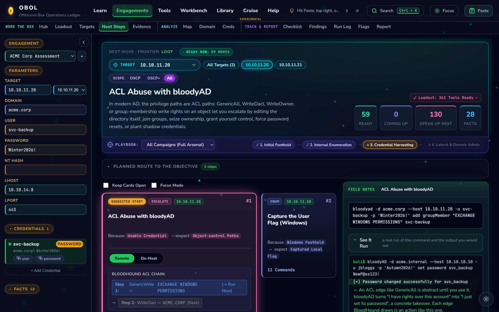

**Live site: https://platocres.github.io/obol/**

> OBOL **never runs commands for you.** It builds them so *you* can review and run them in an
> authorized lab or exam. You stay in control, and every command lands in your own terminal history
> as evidence.

---

## Why OBOL

Studying for the OSCP (or grinding HTB / PG / TryHackMe) is really an exercise in *not getting lost*:
you stare at an open port wondering what to run, forget which cred worked where, scroll a 500-line
cheatsheet for the one command you need, and panic about proof screenshots the night before. OBOL
takes that load off you:

- **It tells you what to do next.** Instead of a cheatsheet, OBOL looks at what you've *proven* about
  a target and hands you a short, ranked list of the next commands worth running, each copy-ready and
  pre-filled with your target, creds, and LHOST, with a one-line "why" and an honest note on what it
  does **not** prove.
- **It only believes your output.** An open port is not a shell. A crackable hash is not a login.
  OBOL mints a fact only when your pasted tool output actually demonstrates it. That is the exact
  discipline the exam graders (and good pentesters) expect.
- **It remembers everything.** Hosts, services, which cred is valid where, what you've already tried,
  flags captured, all tracked, so you never re-scan the same box at 3am.
- **It reads your SharpHound dump.** Drop a BloodHound collection and OBOL draws your owned-to-Domain
  Admin attack paths, answers the high-value queries, and feeds the whole thing back into the coach.
- **It carries a whole workbench.** Reverse-shell builder, hash identifier, encoders, a JWT decoder,
  GTFOBins, a wordlist picker, a manual-SQLi guide, all client-side, all filled from your engagement.
- **It writes your report.** As you capture flags and findings, OBOL assembles an OSCP-style report
  and exports it as Markdown, HTML, PDF, or Word, with the proof discipline and redaction the exam
  requires.
- **It runs entirely on your machine.** A static web page. Your targets, creds, and notes live in
  your browser only. Save the page and it works offline, even during the exam.

---

## The loop: run, paste, get the next move

OBOL watches one thing: **proof**. You run a command in your terminal, paste the output, and OBOL's
conservative parsers mint *facts*, but only for what the output genuinely shows. Every fact is
timestamped, attributed to the command that proved it, and drives everything else, the coach, the
attack graph, the findings, and the report all recompute the instant a new fact lands.

  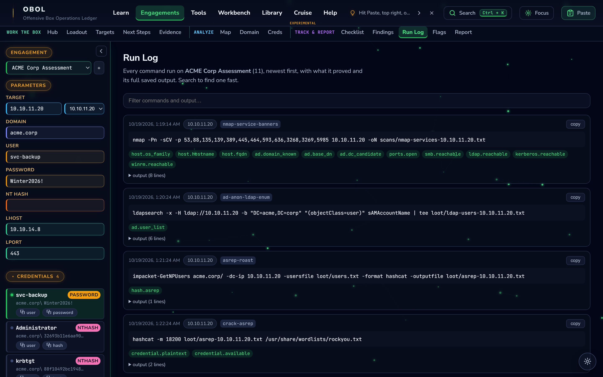

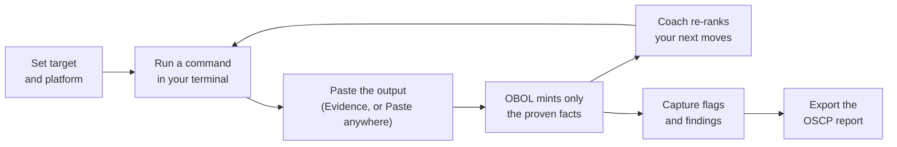

The loop is deliberately tight: **run, paste, get the next move**, over and over, until the box is
rooted. Findings and flags accumulate as you go, so your report is essentially finished the moment
you are.

---

## Turn a SharpHound dump into a route to Domain Admin

Drop a SharpHound `.zip` (or BloodHound-CE `.json` files) on the **Domain** tab and OBOL parses the
whole collection in your browser, nothing is uploaded anywhere. From that one export it derives and
**draws every owned-to-Domain-Admin attack path** as an interactive graph you can pan, zoom, and
rearrange. Owned accounts glow green, nodes you already control are ringed, Domain Admin is red, and
each edge is labelled with the abuse that walks it.

  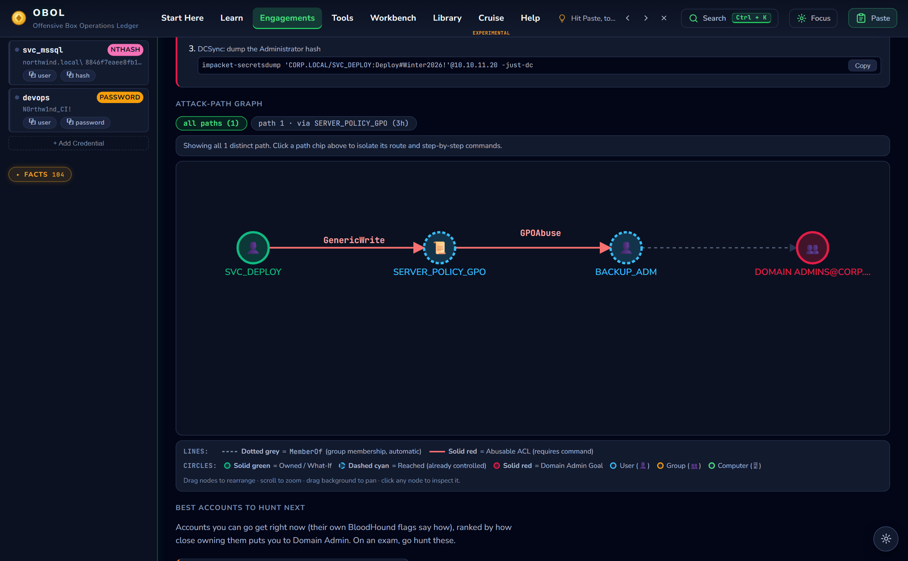

Then it does what a raw BloodHound dump does not: it **hands you the route as numbered, copy-ready
commands** (grant yourself DCSync, dump the Administrator hash, pass it), flags who is Kerberoastable,
AS-REP roastable, or can DCSync, ranks the accounts worth hunting next by how many hops they save, and
bridges the whole thing back to the coach, all pre-filled with your target and credentials.

  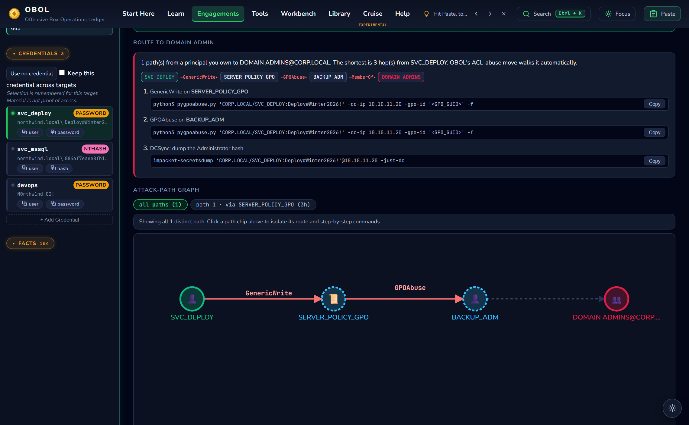

---

## The Workbench: borrowed back-ends, no network

A global **Workbench** of client-side utilities that answer your situation right now, each filling
from your active engagement and working standalone: a reverse-shell builder (every language, plus
one-click Base64 and PowerShell `-EncodedCommand` the way OffSec teaches it), a rule-based hash
identifier with ready crack commands, an all-at-once encoder and a multi-layer smart decoder, a JWT
decoder, a GTFOBins browser, a stack-aware wordlist picker, a manual (exam-legal) SQLi guide, an
"Explain This Output" annotator, and a lockout-aware spray planner.

  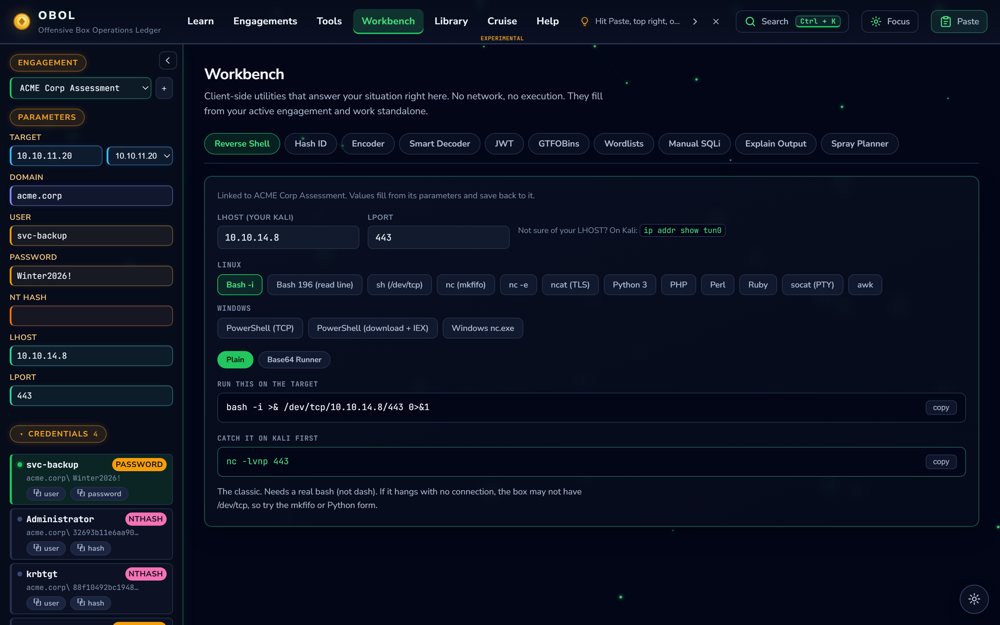

---

## Stuck? Ask the Ferryman

Hit a wall and don't want to paste anything? The **Stuck?** tab is a guided, sandboxed advisor.
Charon, OBOL's namesake ferryman, asks a few quick questions about your target, then lays out ranked
moves to try, in order, using the exact same coach as Next Steps. It never touches your real
engagement unless you ask it to.

  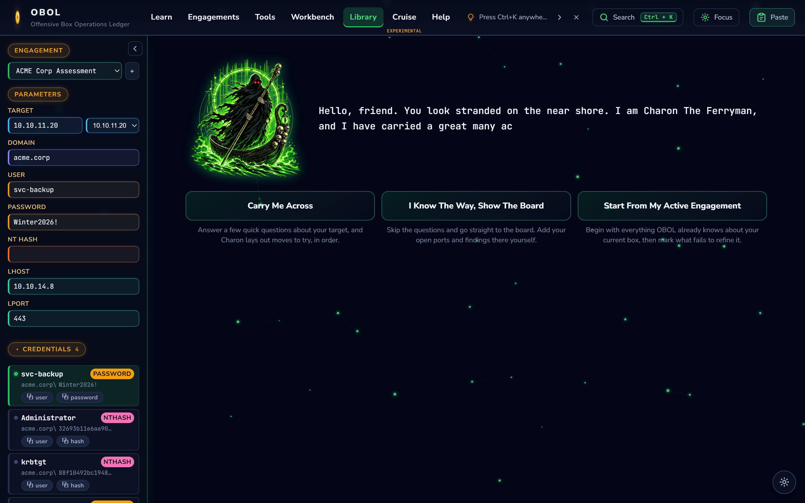

---

## Cruise: hands-off, but exam-legal

**Cruise** is OBOL on autopilot. It hands you a batch of the *safe* enumeration moves you can run
right now, independent of each other; you run them on your own box and paste the output back; OBOL
learns the new facts and hands you the next batch, round after round. It always stops and asks before
anything that lands a shell, sprays credentials, or fires an exploit, so Exam mode stays exam-legal.
A Lab mode batches further for practice.

  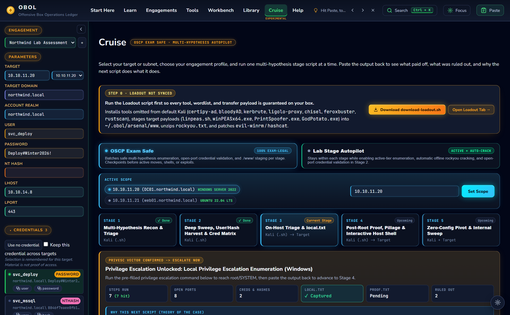

---

## See it the way a blue team would: ATT&CK, D3FEND, compliance

The **Findings** tab carries a Splunk-ES-style framework view, flipped to the offensive side: your
recorded moves and minted findings light up the exact **MITRE ATT&CK** matrix cells a defender's SIEM
would try to detect, with the kill chain across the top. A Defensive sub-view maps each technique to
its **D3FEND** countermeasure and ATT&CK detection; Compliance rolls findings up to NIST / CIS / PCI /
CWE / OWASP; and CVEs flags the CISA KEV "actively exploited" list. Dual-use and educational: it shows
you both the attack and the catch.

  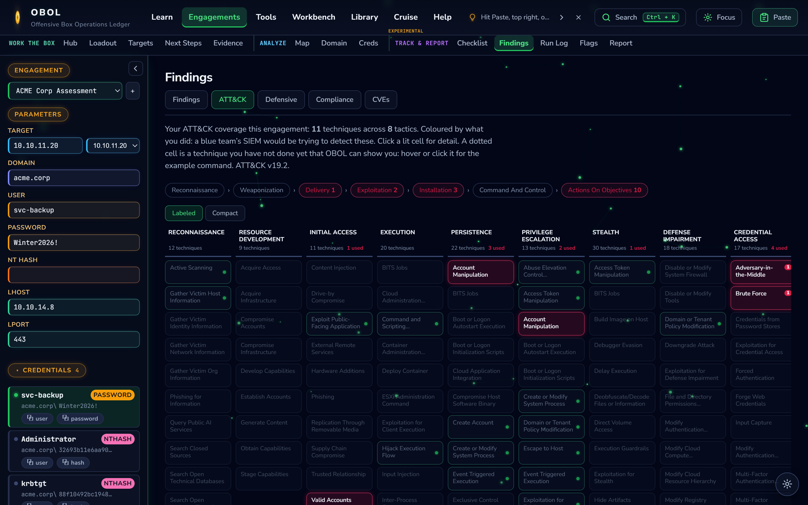

Every finding stays proof-bound: catalogued, grouped by severity or target, each with the fact that
proved it, a remediation, and a CWE reference.

  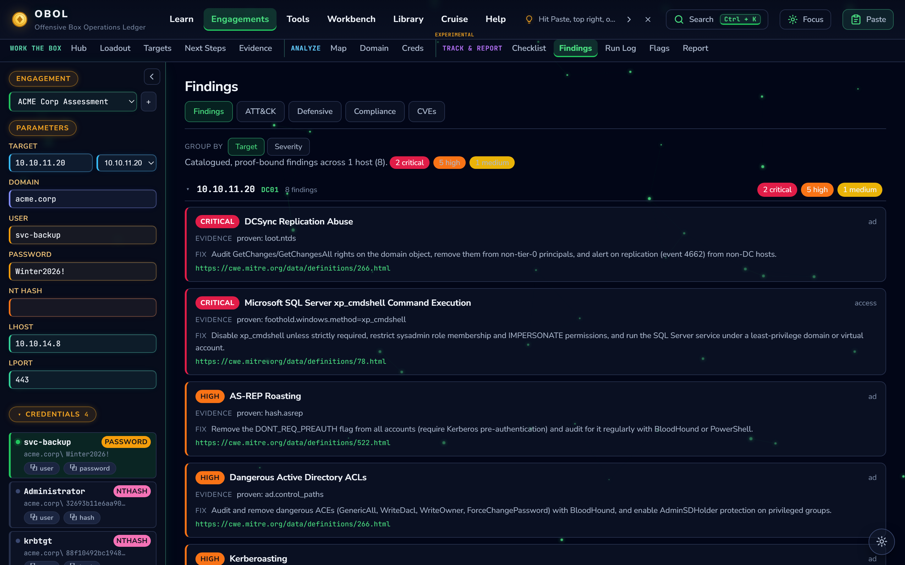

---

## Everything tracked, and an exam-ready report

The **Map** draws the whole engagement from proven evidence alone: scope and domains, every target
coloured by access level, services, credentials, and findings, all hanging from the scope they belong
to.

  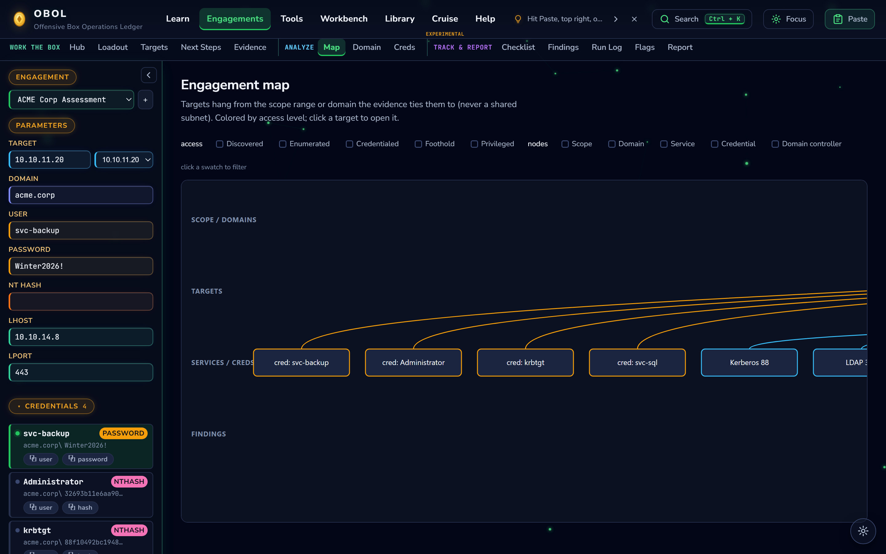

When you're done, **Report** exports an OSCP-style writeup with the proof discipline and redaction the
exam requires, in Markdown, HTML, PDF, or Word. It even calls out readiness gaps, like a flag that
still needs a compliant proof screenshot, before you submit.

  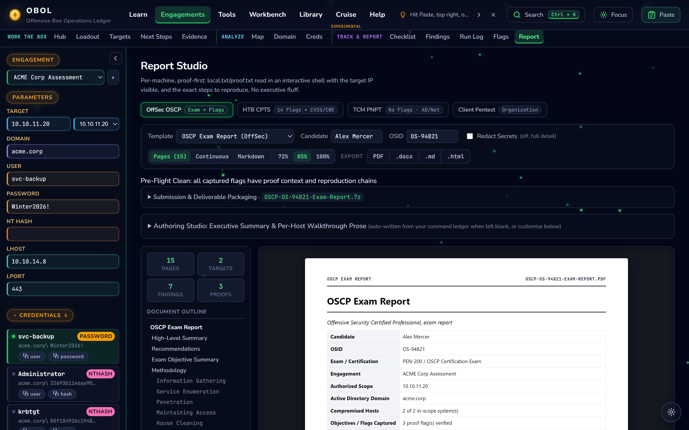

---

## The tabs, in plain terms

**Global** (always available, no engagement needed)

| Tab | What it's for |
|---|---|
| **Learn** | The methodology as a curriculum: study the moves, the field notes, the decision map. |
| **Loadout** | Your attack box. Generates a setup script that installs and pins your toolkit (fixes the common gotchas, like the evil-winrm sealing bug). |
| **Engagements** | Start/switch a run; pick your platform (HTB, OSCP, PWK, TryHackMe, CPTS, CTF, OSWP); set scope. |
| **Tools** | Build a specific tool's command with every flag, presets, and your values filled in. |
| **Workbench** | Client-side utilities: reverse shells, hash ID, encoders, JWT, GTFOBins, wordlists, manual SQLi, and more. |
| **Stuck?** | Charon the Ferryman: answer a few questions, get ranked moves, without pasting anything. |
| **Cruise** | Hands-off, exam-legal batches of safe enumeration; run, paste, advance. *(Experimental.)* |
| **Help** | A map of the whole app, a glossary, and a context-aware `?` on any screen. |

**Inside an engagement**

| Tab | What it's for |
|---|---|
| **Hub** | The box at a glance: what's proven, what's next, where you are. |
| **Targets** | Your boxes. Select one for its personal attack-path page. |
| **Next Steps** | The coach: your ranked, copy-ready next commands with field notes. |
| **Evidence** | Paste tool output and OBOL turns it into proven facts. Also attach proof screenshots. |
| **Map** | The whole engagement: scope, hosts, services, creds, domain, findings. |
| **Domain** | Drop a SharpHound zip for owned-to-DA paths, high-value queries, and a printable report. |
| **Creds** | Which credential works on which host; one-click retarget. |
| **Checklist** | The full methodology, tickable, so nothing gets missed. |
| **Findings** | Proof-bound findings, plus the ATT&CK / D3FEND / compliance / CVE framework views. |
| **Run Log** | Every command you ran, what it proved, and its full saved output. |
| **Flags** | Local/root flags captured and OSCP points vs. the pass threshold. |
| **Report** | Your exportable OSCP/CTF report, with proof discipline and redaction. |

**Pro tip:** hit **Paste** (top-right) on any screen to drop in terminal output, or press
**⌘K / Ctrl+K** to fuzzy-search every command and copy it pre-filled. A skin picker (bottom-right)
sets the console green, amber, or several other themes.

---

## How it works

OBOL is a **static single-page app**: plain HTML, CSS, and vanilla JavaScript, no framework, no build
step, no server. The engine (facts, parsers, methodology packs, findings, report, attack graph) is
pure and UI-independent; the UI routes are thin views over it. All state lives in your browser's
IndexedDB, so an engagement survives a refresh and never leaves the machine.

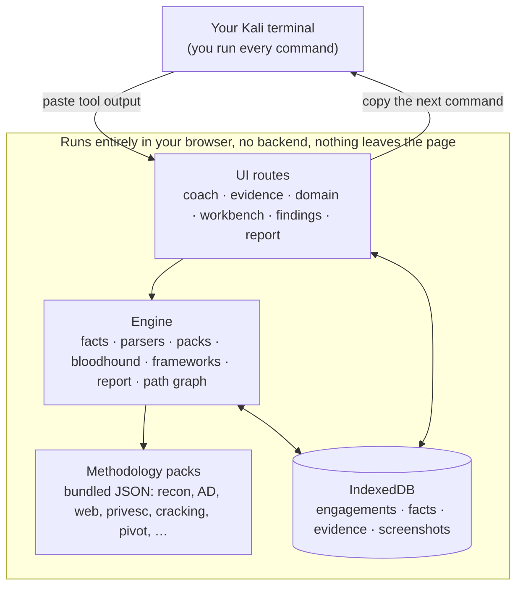

**Design principles**

- **Proof-gated.** Facts are only minted from real tool output; the coach, graph, findings, and
  report are all projections of that fact ledger.
- **No execution, no telemetry.** OBOL builds commands for you to run; it never runs them, and it
  makes no network calls. That is also why it stays exam-legal: it is a deterministic reference and
  notes tool, with no LLM.
- **Offline-first.** Everything is client-side, so the app works from `file://` and keeps running
  with no connection.

---

## A note for exam day

OBOL models the OSCP scoring rules: local + proof flags per machine, the 70-point pass threshold, and
the Active-Directory set's all-or-nothing block. It reminds you when a flag needs a **compliant proof
screenshot** (the flag *and* `ip a` / `hostname` in the same window), which is the most common way
students lose points they earned. OBOL can't take the screenshot for you, but it won't let you forget
it. Everything is browser-local, so keep the tab open (or save the page) during your exam. Nothing is
sent anywhere.

---

## Run it yourself

Open `index.html` in any modern browser: no server, no build step, no dependencies. It works offline.
To host your own copy, drop the folder on any static host (GitHub Pages, Netlify, or even `file://`).
Your engagement data is stored in your browser's local database (IndexedDB); clearing site data resets
it, and different browsers or devices keep separate copies.

Tests live in `tests/` (a pure-Node engine suite and a headless-browser smoke of the real app).

---

## Status and direction

OBOL is under active development, a growing companion rather than a finished product. The methodology
packs, parsers, and coaching keep improving, and you should expect the occasional rough edge.

One thing won't change: **OBOL will never pwn a box for you.** It doesn't run exploits, and it can't
guarantee an end-to-end path to root on every machine, by design. It's a coach that keeps you
oriented, honest, and organized while *you* do the hacking, which is exactly the skill the OSCP is
testing. Where OBOL doesn't yet have a move for some niche service, it won't invent one; it points you
at the next reasonable step and stays out of your way.

The long-term goal is to map **every attribute of a quality penetration test** into OBOL's workflow:
disciplined enumeration, proof-gated findings, the full attack-path methodology, credential and pivot
tracking, and exam-grade reporting, so that working a box in OBOL mirrors how a strong operator
actually thinks and documents.

---

## Legal and ethics

OBOL is for **authorized** labs, training, CTFs, exam preparation, and engagements where you have
explicit permission to test. Don't point it at anything you're not allowed to touch. The ACME.CORP
data in the screenshots above is entirely fictional.

## License

Copyright (C) 2026 platocres.

OBOL is free software, released under the [GNU Affero General Public License v3.0](LICENSE). You may
use, study, modify, and share it under those terms; any distributed or network-served derivative must
remain open under the same license. See [CONTRIBUTING.md](CONTRIBUTING.md) for how contributions are
licensed.
