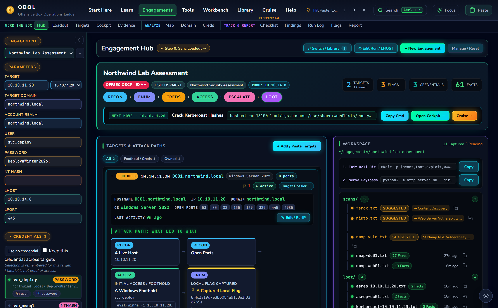
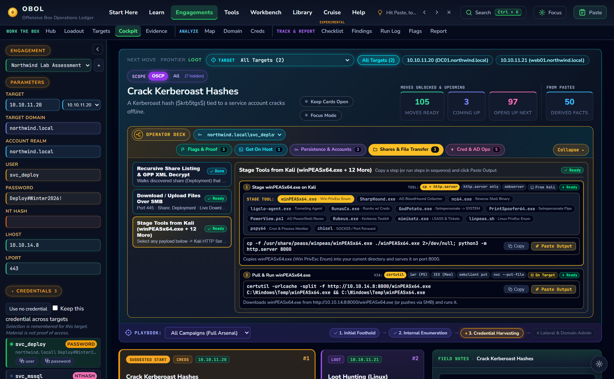
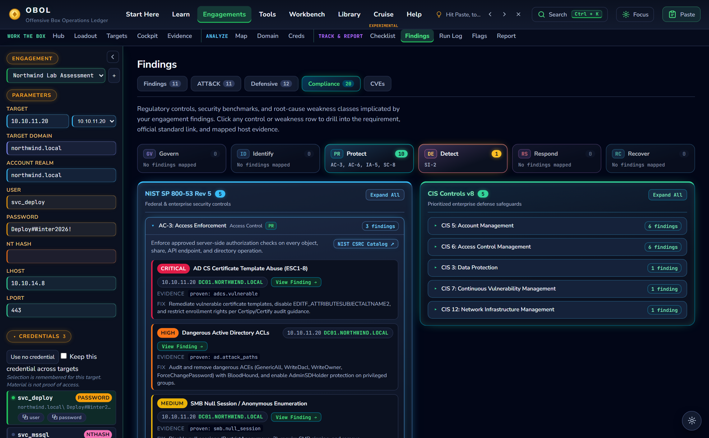
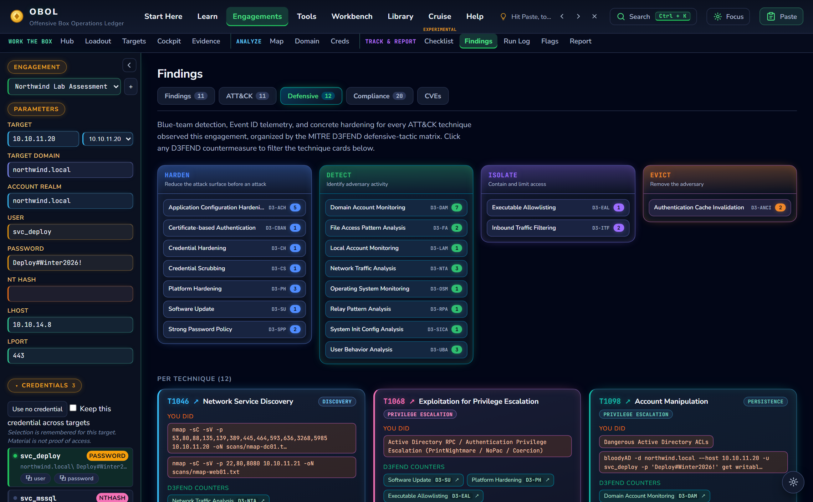
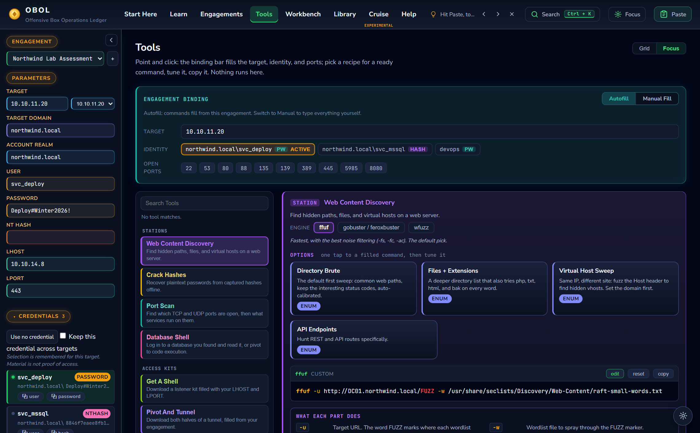
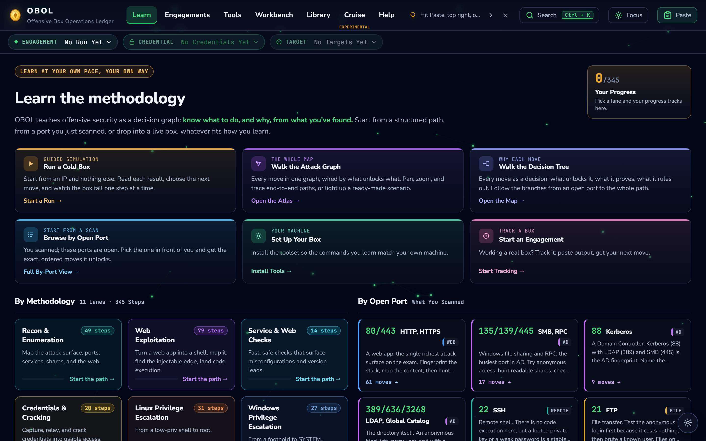
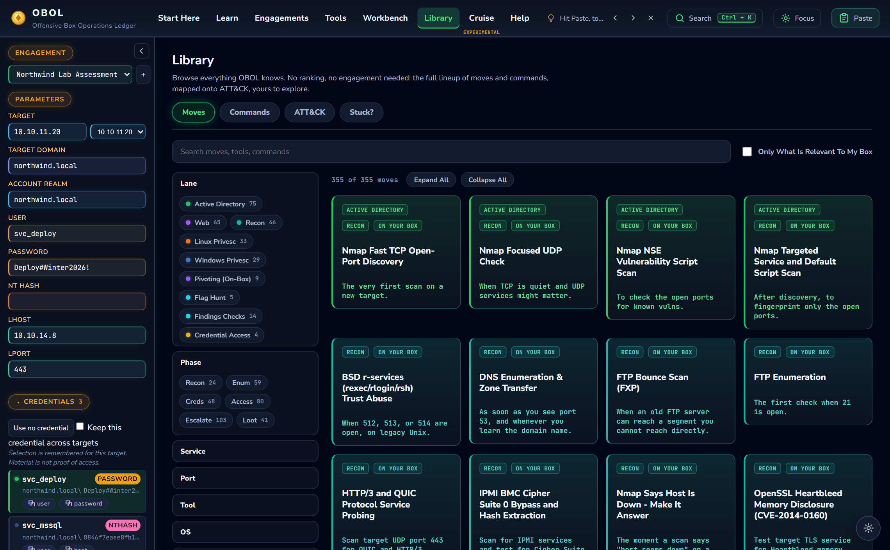

# OBOL - Offensive Box Operations Ledger

**Paste what your tools print. Get the exact next move, pre-filled from what you proved, and ship a finished assessment report when the box falls.**

OBOL is a deterministic, browser-local penetration-testing operator cockpit built for hands-on lab, exam (OSCP, CPTS, PNPT), and internal network assessments. There is no backend, no account, no telemetry, and no model guessing behind a curtain. Every engagements ledger lives locally in your browser's IndexedDB, every fact exists only because terminal output you pasted proved it, and every command auto-fills with your active target, domain, credential, realm, and listener settings.

**Quick Links:** [What's New (Oct 2026)](#whats-new-in-the-october-2026-update) | [Changelog](CHANGELOG.md) | [Architecture](ARCHITECTURE.md) | [Contextual Inference](INFERENCE.md) | [Causal Ranking](RANKING.md) | [Contributing](CONTRIBUTING.md)



---

## What's New in the October 2026 Update

- **355 Moves & 1,923 Commands Across 19 Packs:** Expanded Active Directory (ACL/GPO/ADCS/delegation/cross-trust), Linux and Windows privilege escalation, web exploitation, database pivoting, and post-exploitation coverage with 100% 1:1 4-pillar Field Notes.
- **5-Tab Hero Operator Deck & 13-Payload On-Host Tool Stager (`#/path`):** Instant access to `Flags & Proof` (`CMD`/`PS` toggles + proof checklist), `Get On Host`, `Persistence & Accounts`, `Shares & File Transfer` (matched Kali HTTP/SMB + target pull-and-run cradles for 13 payloads), and `Cred & AD Ops`.
- **217 Terminal Parsers & Deterministic Intelligence (`INFERENCE.md` & `RANKING.md`):** 217 dedicated terminal-output parsers (`2,250+` pattern matchers and `634` fact-minting rules across `17` parser modules, plus 3 structured-artifact parsers = `220` engine-wide) culminating in 3-tier Wittgensteinian Contextual Inference, paired with a 7-tier Causal Frontier & Bayesian Utility Ranker, identity-scoped context (`ObolContext`), truthful outcome receipts (`ObolOutcomes`), and 16+ Error & Trap Doctors.
- **Multi-Domain BloodHound (`#/domain`):** Client-side SharpHound `.zip` / BloodHound CE `.json` Web Worker analysis, cross-trust forest graphs, `What-If` owned principal simulation, and numbered hop commands with automatic intermediate identity handoff.
- **Overhauled 5-Tab Findings & AST-Paginated Report Studio (`#/findings`, `#/report`):** Neon ATT&CK `OBOL Scope` matrix, NIST CSF 2.0 posture with `<details>` control drill-downs, interactive MITRE D3FEND countermeasures, CISA KEV CVE tracking, and paginated paper previews exporting to **PDF**, **`.docx`**, **`.md`**, and **`.html`** across OSCP, CPTS, PNPT, Client Pentest, and Executive profiles.

For the complete release breakdown and earlier milestone history, see **[CHANGELOG.md](CHANGELOG.md)**.

---

## Core Loop: Paste Output, Prove Facts, Run the Next Move (`#/path`)

Most note-taking setups split your attention across a terminal, a cheatsheet tab, a scratchpad of credentials, and a half-finished report template. OBOL closes that loop around a single action: **paste raw terminal output** (`Ctrl+V` anywhere via QuickPaste, or drop multi-command terminal scrollback into the Cockpit).

1. **4-Stage Session Ingestion & 217 Terminal Parsers:** Splits multi-command terminal scrollback, strips ANSI escape codes, auto-learns listener and host context, routes output to the right `host:<ip>`, `domain:<name>`, and credential scope, and evaluates `2,250+` pattern matchers, 2D table/KV mappers, and 45-atom contextual inference across `634` fact-minting rules (`246` distinct fact kinds).
2. **Causal Ranking & Campaign Playbook:** Evaluates all 355 methodology moves against your proven `FactSet` and orders ready hypotheses from immediate flag cash-in and earned credential frontiers down to baseline enumeration.
3. **4-Pillar Field Notes on Every Card:** Every move pairs pre-filled commands with real terminal fixtures (`See It Run`) and structured operator notes (`1 Goal`, `2 Syntax`, `3 Gotchas`, `4 Pivot`).


### 5-Tab Hero Operator Deck & 13-Payload Tool Stager

Pinned directly above your ranked move cards in `#/path`, the **Operator Deck** keeps high-frequency host and domain operations one click away, scoped to whichever credential you select:

- **Flags & Proof:** Two-flag (`local.txt` and `proof.txt`) retrieval one-liners with inline `CMD` / `PowerShell` toggles, interactive proof context (`whoami` + hostname + IP + flag in one frame), and `Educated Guess` vs `Verified Path` badges.
- **Get On Host & Persistence:** Pre-filled interactive shell upgrades (`evil-winrm`, `impacket-psexec`, `impacket-wmiexec`, `xfreerdp`, `ssh`) and authorized lab access-maintenance helpers.
- **Shares & File Transfer (13-Payload Tool Stager):** Select any of 13 common assessment binaries (`winPEASx64.exe`, `linpeas.sh`, `SharpHound.exe`, `ligolo-agent.exe`, `chisel`, `GodPotato.exe`, `PrintSpoofer64.exe`, `RunasCs.exe`, `Rubeus.exe`, `PowerView.ps1`, `mimikatz.exe`, `nc64.exe`, `pspy64`) to generate a matched **Stage on Kali** command (`python3 -m http.server` or `impacket-smbserver`) and **Pull & Run on Target** cradle (`certutil`, `iwr`, in-memory `IEX`, `smbclient`, or `nxc --put-file`).
- **Cred & AD Ops:** Rapid credential spray/validation, roasting, secrets dumping, and ACL/ADCS checks bound to your active domain controller.



### Identity-Scoped Context, Truthful Outcomes & Deterministic Intelligence

- **Identity-Scoped Context (`ObolContext`):** Isolates target host, target domain, authentication realm, principal, credential secret/NT hash, service, and execution locus (`On Kali` vs `On Target`). A local account on `WEB01` is never conflated with a domain account on `DC01`.
- **Truthful Outcome Receipts (`ObolOutcomes`):** Separates *an observation* from *operation completion* across `success`, `duplicate`, `completed-negative`, `authorization-denied`, `rejected`, `environment-error`, and `partial`. When a command hits Kerberos clock skew (`KRB_AP_ERR_SKEW`), an IP-based SPN error, OpenSSL 3 legacy FreeRDP TLS rejection, a WMI `Set-WSManQuickConfig` network-token block, or a ping-filtered scan, OBOL surfaces a copy-ready **Error Doctor** fix without retiring the underlying move. When `find -perm -4000`, `whoami /priv`, or `sudo -l` returns only stock unprivileged baselines, OBOL flags the dead end and points to the next escalation vector.
- **Inspectable Math, Zero Black Box:** Read **[INFERENCE.md](INFERENCE.md)** for the 3-tier parser and Wittgensteinian contextual inference cascade, and **[RANKING.md](RANKING.md)** for the 7-tier Causal Frontier & Bayesian utility equations.

---

## Client-Side Multi-Domain BloodHound (`#/domain`)

Drop a SharpHound `.zip` collection or BloodHound CE `.json` files straight into `#/domain` (or load one of the 3 built-in single-domain, multi-domain forest trust, and delegation topologies). Parsing and shortest-path graph traversal run locally inside a Web Worker; nothing is uploaded anywhere.

- **Interactive SVG Attack-Path Graph:** Filter distinct paths to Domain Admin, drag and zoom nodes, inspect inbound/outbound ACLs, or toggle `What-If` ownership on high-value accounts to test hypothetical compromises before spending time roasting or cracking them.
- **Numbered Route to Domain Admin with Identity Handoff:** Translates abstract BloodHound edges (`GenericAll`, `WriteDacl`, `WriteOwner`, `ForceChangePassword`, `AddKeyCredentialLink`, `GPOAbuse`, `ReadGMSAPassword`, `ReadLAPSPassword`, `AllowedToAct`, `HasSession`, `AdminTo`) into ordered, copy-ready commands (`bloodyAD`, `certipy`, `pygpoabuse.py`, `impacket-*`, `nxc`) that automatically hand off newly compromised principals from hop to hop.


<details>
<summary><strong>More screenshots: Numbered Route to Domain Admin &amp; Copy-Ready Hop Commands</strong></summary>

<br>


</details>

---

## 5-Tab Findings, Neon ATT&CK, Compliance & MITRE D3FEND (`#/findings`)

As you prove facts and exploit paths, OBOL automatically builds a structured offensive and defensive ledger across five dedicated views:

1. **Findings:** Deduplicated, severity-scored findings backed by proven facts and raw command evidence, complete with CVSS v3.1 vectors, CWE mappings, and remediation steps.
2. **ATT&CK (`OBOL Scope` & `Full Enterprise`):** Color-coded Enterprise ATT&CK v15 matrix defaulting to `OBOL Scope` (the techniques directly mapped across OBOL's 355 moves and findings catalog), highlighting observed techniques with hit counts and per-host drill-downs.
3. **Compliance (NIST CSF 2.0 + 5 Frameworks):** Top-level NIST CSF 2.0 posture strip (`Govern`, `Identify`, `Protect`, `Detect`, `Respond`, `Recover`) above expandable `<details>` control cards spanning NIST SP 800-53 Rev. 5, PCI-DSS v4.0, CIS Controls v8, ISO/IEC 27001:2022, and OWASP Top 10 / ASVS.
4. **Defensive (Interactive MITRE D3FEND & Telemetry):** 6-column MITRE D3FEND countermeasure matrix (`Model`, `Harden`, `Detect`, `Isolate`, `Deceive`, `Evict`) with click-to-filter blue-team cards listing Windows Security Event IDs, Sysmon telemetry rules, and hardening commands.
5. **CVEs & CISA KEV:** Extracted CVEs correlated against service banners and the bundled CISA Known Exploited Vulnerabilities (KEV) catalog.


<details>
<summary><strong>More screenshots: NIST CSF 2.0 Compliance Drill-Downs &amp; Interactive MITRE D3FEND Matrix</strong></summary>

<br>



<br>



</details>

---

## AST-Paginated Multi-Profile Report Studio (`#/report`)

Turn your engagement ledger directly into a submission-ready exam report or client deliverable without copying and pasting terminal blocks by hand:

- **One-Click Deliverable Profiles:** Switch live between **OffSec OSCP** (exam + flags + reproduction walkthroughs), **HTB CPTS** (commercial pentest structure + CVSS/CWE), **TCM PNPT** (narrative AD/network assessment without CTF flag sections), **Client Pentest**, and **Executive Brief**.
- **Deterministic AST Paper Pagination:** Renders true paginated paper sheets (`Pages`, `Continuous`, or raw `Markdown`) that keep headings attached to body prose, split multi-page tables with repeated column headers, and pair `local.txt` / `proof.txt` proof screenshots with automated **Report Readiness Pre-Flight** checks (`whoami` + IP + flag verification and exam-restricted tool warnings).
- **Redaction, Authoring Overrides & 4 Export Formats:** Toggle **Redact Secrets** for safe sharing, customize executive or per-host narrative prose in the Authoring Studio, export to **PDF**, editable **Microsoft Word (`.docx`)**, **Markdown (`.md`)**, or self-contained **HTML (`.html`)**, and copy exact `7z` archive + SHA-256 verification commands from the Submission Packaging drawer.


---

## 11-Studio Offline Workbench (`#/workbench`), Tools Focus Lens (`#/tools`) & Pivot Wizard

When you need to craft a custom payload, decode a token, tune a fuzzer, or stand up a multi-hop tunnel, OBOL provides two dedicated builder workspaces pre-filled from your live engagement telemetry:

- **11-Studio Offline Workbench (`#/workbench`):**
  - *Shells & Delivery:* `Reverse Shells & TTY` (Bash, Python, PHP, PowerShell TCP/IEX, ConPTY, `msfvenom` stagers, minimal PHP/ASPX/JSP webshells, and PTY stabilization), `File Transfer`, and `Pivot & Tunnels` (matched two-machine commands for `Ligolo-ng`, `Chisel`, `SSH`, `sshuttle`, `socat`, and `netsh` plus `Pivot Doctor`).
  - *Cracking & Auth:* `Hash ID & Extractors` (`hashcat` / `john` modes + `*2john` helpers), `JWT Studio` (decode, `alg:none`, live HS256 forgery), and `Spray Planner` (lockout-safe `nxc` / `kerbrute` loops).
  - *Codecs, Web & Privesc:* `Encode & Decode`, `Manual SQLi`, `Wordlists & Fuzzing`, `GTFOBins & LOLBAS`, and `Output & Error Doctor`.
- **Tools Grid & Focus Lens (`#/tools`):** Task-oriented command stations (`Web Content Discovery`, `Crack Hashes`, `Port Scan`, `Database Shell`), downloadable `Get A Shell` and `Pivot And Tunnel` kits, and 50+ interactive recipe builders with a live **What Each Part Does** flag-by-flag glossary.


<details>
<summary><strong>More screenshots: Tools Focus Lens &amp; Live Flag-by-Flag Command Glossary</strong></summary>

<br>



</details>

---

## Start Here (`#/start`), Learn (`#/study`), Library (`#/library`), Manual (`#/help`) & Cruise (`#/cruise`)

Whether you are onboarding onto your first lab network, drilling methodology offline, or running batched recon sweeps:

- **Start Here (`#/start`) & Arsenal Loadout (`#/loadout`):** Launch a fresh engagement, jump into 1 of 5 pre-built practice scenarios, or generate a Kali loadout verification script so missing tools (`certipy-ad`, `bloodyAD`, `ligolo-proxy`, `chisel`, `feroxbuster`, `winPEASx64.exe`, `linpeas.sh`, `GodPotato.exe`) are staged before exam day.
- **Learn Mode (`#/study`):** Practice offensive methodology as a decision graph across **11 methodology lanes**, **open-port playbooks**, an interactive **Attack Graph Atlas**, a **Decision Tree** explorer, and **37 step-by-step cold-box simulations**.
- **Reference Library (`#/library`) & Operator Manual (`#/help/manual`):** Browse all 355 moves, 1,923 commands, ATT&CK mappings, and `Stuck?` dead-end diagnostics with zero ranking filter, backed by a searchable 7-chapter Operator Manual and 32-term glossary.
- **7 Skins, Focus Mode & Kali VM Performance:** Switch across 7 WCAG-AA contrast-audited skins, collapse navigation chrome with Focus Mode, and toggle reduced-motion / GPU-light rendering for smooth operation inside virtualized Kali environments.
- **Cruise Mode (`#/cruise`, Experimental):** Multi-hypothesis 5-stage bash script generator (`Stage 1: Recon & Triage` through `Stage 5: Zero-Config Pivot & Internal Sweep`) offering both an **OSCP Exam Safe** profile (checkpoints before active exploitation) and a **Lab Stage Autopilot** profile.

<details>
<summary><strong>More screenshots: Learn Methodology Lanes, 355-Move Reference Library &amp; Cruise 5-Stage Pipeline</strong></summary>

<br>



<br>



<br>


</details>

---

## What OBOL Does Well (And Honest Boundaries)

OBOL is designed to be a sharp, trustworthy instrument rather than magic:

- **Where OBOL shines:** Structured service enumeration, Active Directory attack chains, credential/hash hygiene across multi-host networks, privilege-escalation triage, error recovery when tools misbehave, keeping proof screenshots and flags organized under time pressure, and generating clean exam or client reports directly from your command ledger.
- **What OBOL intentionally does not do:**
  - **It never executes commands or sends network traffic.** Your browser cannot scan a target for you; you run every command in your own terminal and paste back the output you want analyzed.
  - **It does not replace custom source-code auditing or novel exploit authorship.** OBOL recognizes known vulnerability classes, version matches, LFI/SQLi/SSTI/SSRF signals, and configuration flaws, but bespoke business-logic bugs in custom web applications still require reading the application yourself.
  - **It never guesses unproved facts.** If you forget to paste an output block (or manually record a fact via the Fact Picker), OBOL will not assume a port is open or a credential works.

---

## Running Locally

OBOL is a zero-dependency static web application. Clone the repository and serve the root directory with any local HTTP server (recommended so Web Workers and clipboard APIs run with full browser permissions):

```bash
git clone https://github.com/platocres/obol.git
cd obol
python3 -m http.server 8080
```

Then open `http://localhost:8080` in Chromium, Firefox, or Brave (or use `npx serve .`). Core surfaces also degrade gracefully when opened directly via `file:///.../index.html` using a synchronous fallback for BloodHound parsing.

---

## Repository Layout

```text
index.html                 Single-page application entry point & critical boot path
README.md                  Operator tour & quickstart guide
CHANGELOG.md               Release history & major feature milestones
ARCHITECTURE.md            Layered engine/UI/data architecture & lazy-loading guide
INFERENCE.md               3-tier parser & Wittgensteinian contextual inference specification
RANKING.md                 7-tier Causal Frontier & Bayesian utility ranking specification
CONTRIBUTING.md            Developer Certificate of Origin & contribution guidelines
LICENSE                    GNU Affero General Public License v3.0 (AGPL-3.0)
assets/
  css/obol.css             Design tokens, 7 WCAG-AA skins, print rules & responsive layout
  jszip.min.js             Client-side SharpHound .zip & .docx packaging support
  engine/                  Pure UI-independent engine (facts, context, pack ranker, outcomes,
                           bloodhound, frameworks, report, cruise, workbench, workers/, and
                           parsers/: 17 modules, 217 terminal parsers, 2,250+ pattern matchers)
  ui/                      IndexedDB store, hash router, lazy group loader, 4-stage session
                           ingest, global Ctrl+K palette, and routes/ (21 routes across 18 modules)
data/
  packs-bundle.js          Compiled methodology bundle (19 packs, 355 moves, 1,923 commands)
  tool-staging.js          13-payload on-host staging catalog & matched cradle definitions
  findings-catalog.js      Findings definitions, CVSS/CWE metadata & remediation templates
  attack-catalog.js        Enterprise ATT&CK v15 & OBOL Scope move/finding mappings
  d3fend-map.js            MITRE D3FEND countermeasure matrix & blue-team telemetry mappings
  frameworks-tables.js     NIST CSF 2.0, NIST 800-53, PCI-DSS, CIS v8, ISO 27001 & OWASP tables
  study-fixtures.js        355 1:1 move study fixtures & 37 practice box walkthroughs
  help-content.js          7-chapter searchable Operator Manual & 32-term glossary
screenshots/               1080p UI screenshots referenced in README.md
```

---

## Authorized Use & Legal Disclaimer

OBOL is built strictly for **authorized security assessments, penetration testing engagements, and educational lab or exam environments** (such as OSCP, Hack The Box, and Proving Grounds):

- **Authorized Targets Only:** You must own the target environment or hold explicit, verifiable written authorization from the system owner for every IP address, hostname, domain, credential, or artifact you enter into or test alongside OBOL.
- **Zero-Execution Companion - Sole Operator Responsibility:** OBOL runs locally in your browser, generates zero network traffic, and executes zero commands. Every command, payload, or HTTP request you copy and run in an external terminal, browser, or tool is executed solely at your own election, risk, and legal responsibility in compliance with all applicable laws (including the U.S. Computer Fraud and Abuse Act, `18 U.S.C. § 1030`, and applicable local equivalents).
- **Provided "AS IS" - No Warranty or Liability:** Pursuant to Sections 15 and 16 of the GNU Affero General Public License v3.0 (`AGPL-3.0`), OBOL is provided `"AS IS"` without warranty of any kind. The authors and copyright holders assume zero liability for target disruption, service instability, account lockouts, data loss, exam or engagement outcomes, or unlawful misuse.
- **Independent Project - Third-Party Trademarks:** OBOL is an independent open-source project and is not affiliated with, endorsed by, or sponsored by OffSec, PortSwigger, SpecterOps, Hack The Box, or any other third-party vendor. Referenced tool and platform names (including Nmap, NetExec, Impacket, BloodHound, SharpHound, Hashcat, Chisel, Ligolo-ng, GTFOBins, and Burp Suite) are trademarks or projects of their respective owners and are named solely for interoperability and instructional reference.

---

## License

OBOL is released under the **GNU Affero General Public License v3.0** ([LICENSE](LICENSE)). See [CONTRIBUTING.md](CONTRIBUTING.md) for contribution terms.
